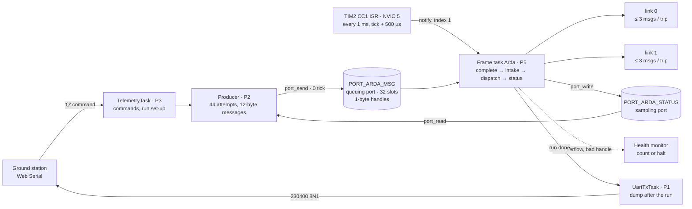

# FrameTrace

**Lossless messaging under burst load on STM32F407 + FreeRTOS: what does the consumer have to look like so that
nothing is lost and nothing misses its deadline?**


[Türkçe](README.tr.md) · [Design notes](docs/design.md) · [Requirements](docs/requirements.md) · [Measurement data](measurements/README.md)

Continues the PressTrace series ([presstrace-stm32](https://github.com/ardagmrkc/presstrace-stm32),
[-fastpath](https://github.com/ardagmrkc/presstrace-fastpath), [-sched](https://github.com/ardagmrkc/presstrace-sched)):
same board, ground station and SystemView measurement chain. No button this time: the load is a producer burst,
and the question is what the consumer must look like so that nothing is lost and nothing misses its deadline.

A producer sends 44 messages; 24 of them arrive back to back. Three textbook queue consumers are measured first,
and they lose messages. The SystemView traces show exactly where and why. A time-triggered frame consumer is then
built one step at a time: an ARINC 653-style port layer, deadline accounting, two links, batched service and a
hardware-phased frame. Every step is predicted before it is measured.

<p align="center"></p>

## At a glance

- **What is measured:** for every message, the send call, the wait from generation to the start of its service
  (`g2r`) and the service time. All timestamps come from one 1 MHz hardware timer (TIM2). Results stay in RAM
  during a run and are dumped over UART afterwards, so the line is silent while the system is measured.
- **Data:** 6 baseline runs (3 consumers × normal / burst load) and 3 frame-consumer runs on the board, plus a
  real-kernel host simulation for the intermediate steps. Every board run is backed by a dump or a SystemView trace
  in this repository.
- **Finding 1: a queue does not absorb a burst, it chooses what to lose.**
  - Capacity 4, no wait (A): 20 of 44 lost.
  - Capacity 16 (B): 8 lost, and the survivors wait up to 300 ms.
  - Capacity 4 with a 20 ms send timeout (C): 10 lost, every second message of the burst. The trace shows why:
    the producer's timeout and the consumer's 20 ms service expire on the same tick, and the higher-priority
    producer runs first.
- **Finding 2: losing nothing is not the same as being on time.** A consumer that drains the queue every 1 ms and
  owns the capacity loses nothing in every run (44/44). With the same 20 ms service, though, the burst's debt leaks
  into later messages for 481 ms.
- **Finding 3: the deadline is met by design, not by tuning.**
  - Modelling the service as the 15-byte frame's transmission time (651 µs, rounded to the 1 ms frame) brings the
    worst wait to 23.7 ms, with 4 messages late.
  - Two links, batched service and a frame phase-shifted by TIM2 bring it to **6.86 ms**, with 0 late.
  - The whole burst is delivered 8.58 ms after its first message. Normal messages wait ≈ 0.48 ms; before the phase
    shift it was 988 µs.
- **Verification:**
  - Over 2 051 frames, the frame starts 498.9–500.1 µs after the tick edge, and frames are 999.90–1000.18 µs apart.
  - The on-board deadline counter equals the number of recorded waits above 20 ms (simulation).
  - Fault injection: a corrupted message handle turns 4 checks red; nothing is lost silently.

## Experiment

**Load contract** (identical in every run):

| Phase | Attempts | Spacing |
|---|---|---|
| Normal | 1–10 | 100 ms after each |
| Burst | 11–34 | back to back, no wait |
| Normal | 35–44 | 100 ms after each |

In normal load all 44 attempts are 100 ms apart. A message is 12 bytes: sequence number, generation time (TIM2, µs)
and run number. The run number lets the consumer reject a message from another run.

**Baseline consumers.** They differ in one factor each:

| Variant | Queue capacity | Send timeout | Consumer |
|---|---|---|---|
| **A** | 4 | 0 | blocks on the queue, 20 ms service per message |
| **B** | **16** | 0 | same |
| **C** | 4 | **20 ms** | same |

The priorities are the same in all three: producer 2, consumer 1, command task 3.

**Frame consumer (task `Arda`).** Each step adds one change on top of the previous one:

| Step | Change | On the board |
|---|---|---|
| 1 | Time-triggered frame task at the highest priority, polling every 1 ms. Messages live in a static table and the queues carry 1-byte handles. Every wait is 0 ticks, and the table is sized at compile time. | record 08 |
| 2 | Service = transmission time of a 15-byte binary frame (sync, type, 12-byte message, CRC) at 230400 8N1: 651 µs, rounded to one frame. The load is unchanged. | record 09 |
| 3 | ARINC 653-style port layer: a queuing port for messages and a sampling port for status. A health monitor, deadline accounting (20 ms; late messages are served and counted, never dropped), and service start stamped at the frame start. | host simulation |
| 4 | A second courier = a second link. | host simulation |
| 5 | Batched service: up to 3 messages per trip, back to back on one link, striped across links. | host simulation |
| 6 | The frame comes from TIM2, 500 µs after the SysTick edge, instead of from the tick. | record 14 (trace) |

**Constraints for every run:**
- static allocation only;
- every queue and port operation on the data path waits 0 ticks;
- tracing compiled in, so its overhead is part of every number;
- the UART stays silent during a run (a 50 ms settle delay lets the run-confirmation line leave first).

## Results

**Baseline, measured on the board** ([`measurements/queue_summary.csv`](measurements/queue_summary.csv)):

| Run | Variant / load | Accepted | Lost | Queue peak | Worst wait (g2r) | Failed send call |
|---|---|---:|---|---:|---:|---:|
| 01 | A / normal | 44 | 0 | 1 / 4 | 26 µs | — |
| 02 | B / normal | 44 | 0 | 1 / 16 | 26 µs | — |
| 03 | C / normal | 44 | 0 | 1 / 4 | 26 µs | — |
| 04 | A / burst | 24 | **20** (15–34) | 4 / 4 | 59.97 ms | 3.1 µs |
| 05 | B / burst | 36 | **8** (27–34) | 16 / 16 | 299.87 ms | 3.1 µs |
| 06 | C / burst | 34 | **10** (16, 18, …, 34) | 4 / 4 | 80.07 ms | 19.95 ms (blocked) |

<p align="center"></p>

*Per-message timeline of runs 04–06 (labels in Turkish). Purple: blocked in the send call; amber: waiting in the
queue; blue: 20 ms service; red ×: failed send.*

**Frame consumer under the same burst:**

| Record | Steps | Service / message | Lost | Worst wait (g2r) | Over 20 ms | Burst delivered after | Source |
|---|---|---|---|---:|---|---:|---|
| 08 | 1 | 20 ms | 0 / 44 | 460.67 ms | 28 (12–39) | 480.98 ms | board dump |
| 09 | 1–2 | 651 µs → 1 ms | 0 / 44 | 23.67 ms | 4 (31–34) | 24.98 ms | board dump |
| — | 1–3 | same | 0 / 44 | 23.81 ms | 4 (31–34) | — | simulation |
| — | 1–4 | + 2nd link | 0 / 44 | 11.85 ms | 0 | — | simulation |
| — | 1–5 | + batches of ≤ 3 | 0 / 44 | 8.15 ms | 0 | — | simulation |
| 14 | 1–6 | + TIM2 phase | 0 / 44 | **6.86 ms** | **0** | **8.58 ms** | board trace |

- In record 08, messages 35–39 wait up to 381 ms although they arrive 100 ms apart. The burst's debt leaks into
  normal traffic.
- Each step was predicted before it was measured:
  - Record 08: 463 ms predicted, 460.7 ms measured.
  - Record 09: 23.9 ms predicted, 23.7 ms measured.
  - Record 14: 7.6 ms predicted, 6.86 ms measured. The prediction assumed the burst ends before the first frame; it
    no longer does, see [lesson 3](#three-lessons-from-record-14).

## What the traces show

Every image below is an annotated SystemView screenshot. Each lettered square marks what its matching note explains.
The notes name the code that produced each event.

### Reading a SystemView window


<details><summary>What each part of the window is (A–P)</summary>

- **A · Events list.** One row per recorded event: index, time (s), context, event. Clicking the timeline scrolls
  the list there.
- **B · Visible span.** The time from the left to the right edge of the timeline (171 µs here).
- **C · Cursor and absolute time.** In *Marker Center* mode the cursor sits in the middle; the bold number is its
  time since the start of the recording. Axis labels are ± µs relative to it.
- **D · Core 0 row.** A one-line summary of which context owns the CPU. Colour = context: SysTick orange, Producer
  green, Consumer teal, grey = scheduler.
- **E · Interrupt rows.** Names come from the description the firmware sends at the start of a recording
  (`SEGGER_SYSVIEW_SendSysDesc("I#15=SysTick")`). Number = 16 + IRQn; USART2's IRQn is 38, so #54.
- **F · PendSV and SVCall rows are always empty.** The FreeRTOS port calls no trace macro inside them. PendSV's work
  (the context switch) shows up in the *Scheduler* row.
- **G · Scheduler row.** The time between one task giving up the CPU and the next one starting: list operations
  after *Task Block* (`vListInsert`, `xTaskResumeAll`) and PendSV.
- **H · Task rows, ordered by priority.** Names are the ones passed to `xTaskCreateStatic`. Of two Ready tasks, the
  higher row wins.
- **I · The number above a bar.** The duration of that piece. Solid bar: running; faint box: Ready but waiting; Idle
  row: idle time.
- **J · Faint box = Ready.** The task is ready but does not have the CPU. It starts at *Task Ready*
  (`prvAddTaskToReadyList`, tasks.c:289) and ends at *Task Run*.
- **K · Grey dot and dashed line = a message's lifetime.** The grey dot is a Start Marker
  (`APP_TRACE_Q_SEND_BEGIN` → `SEGGER_SYSVIEW_MarkStart`). The line ends at a red dot (MarkStop: `DONE` or
  `SEND_FAIL`) and runs along the row of the task where it ends. Here it drops to the Consumer row: message 2 will be
  served.
- **L · Small ticks under a bar.** One tick per event recorded in that context: API entry (`traceENTER_…`), an
  application event, a list operation. Their density shows how busy the kernel is.
- **M · Idle time.** No task is ready. 996.0 µs = the 1 ms tick period minus the tick interrupt's own ~3.7 µs.
- **N · CPU Load panel.** Context shares over the visible span, in 100 bins. In this run the CPU is 0.55 % busy.
- **O · Context panel.** Per-context counts: activations, total run time, shortest / longest run.
- **P · Status bar.** Number of events in the recording (30 572) and its length (7.017 s).

</details>

### Baseline under burst: variant C (run 06)

Capacity 4, 20 ms send timeout. Trace: [`analysis/systemview/C_yogun.SVDat`](analysis/systemview/C_yogun.SVDat).

#### C0 · The whole run, 2.15 s


<details><summary>Notes (A–H)</summary>

- **A · Run start: "i" icon and the first Start Marker.** `APP_TRACE_Q_RUN_BEGIN` names the queue
  (`SEGGER_SYSVIEW_NameResource` → "MsgQ4") and prints "Kosu 6 C/yogun MsgQ4". Message 1's grey dot follows.
- **B · A single UART trace ~50 ms before the run.** The QRUN line confirming the run leaves the line. The producer
  waits 50 ms before its first send so that the line is silent during the measurement.
- **C · The SysTick row looks hatched.** One SysTick per 1 ms, ~2 150 in this window, drawn on top of each other.
- **D · Normal load: one message per 100 ms.** Grey dot on the Producer row (SEND_BEGIN), red dot on the Consumer row
  20 ms later (DONE).
- **E · The burst (1.78 s).** Attempts 11–34 are sent without a wait. Invisible at this scale: the lines of 16, 18,
  …, 34 stay on the Producer row. Those are the lost ones.
- **F · The queue drains.** Red dots 20 ms apart on the Consumer row: the accepted burst messages are served one by
  one. The last one (33) finishes at 2.06 s.
- **G · Cursor: start of the burst** (1.780 727 s). Zooming in here gives C3.
- **H · Thin lines on the Scheduler row.** Every context switch is one line. A pair per 20 ms in normal load, denser in
  the burst.

</details>

#### C1 · A normal message: number 2 is sent

The producer wakes from its 100 ms sleep and sends message 2. The message wakes the consumer waiting on the queue,
but the consumer can only run once the producer sleeps again. 69 µs in total; then the CPU is idle.


<details><summary>Notes (A–H)</summary>

- **A · SysTick box "6.8 us".** 3.7 µs when nobody wakes. This time it moves the producer from the delayed list to the
  ready list and requests PendSV (`xTaskIncrementTick` → `portNVIC_PENDSVSET_BIT`, port.c:455–461).
- **B · Producer's faint box "5.8 us".** Ready, waiting for SysTick to end and PendSV to switch context.
- **C · Grey dot: Start Marker 1002.** `SEGGER_SYSVIEW_MarkStart(1002)` inside `APP_TRACE_Q_SEND_BEGIN(2)`. The dashed
  line drops to the Consumer row: message 2 will be served.
- **D · Consumer's faint box "24.3 us".** The send made the waiting consumer Ready (`xTaskRemoveFromEventList`,
  queue.c:1049). Priority 1 < 2: it waits until the producer blocks.
- **E · Producer bar "28.5 us".** All of the producer's work: SEND_BEGIN, `xQueueSend`, SEND_OK, `vTaskDelay(100)`.
- **F · Scheduler "8.8 us".** From the producer's *Task Block* to the consumer's *Task Run*: `vListInsert` into the
  delayed list, `xTaskResumeAll` and PendSV.
- **G · Consumer bar "13.2 us".** RECEIVE 2 and `vTaskDelay(20)`. No `xQueueReceive` event here: the consumer resumes
  inside the call it entered 80 ms ago; API events are written only on entry.
- **H · The dashed line runs on to the right.** Message 2 now belongs to the consumer. The line ends 20 ms later at
  DONE 2 (C2).

</details>

#### C2 · 20 ms later: the service ends, the queue is empty


<details><summary>Notes (A–F)</summary>

- **A · SysTick "6.7 us".** This time it wakes the consumer: its 20-tick `vTaskDelay` has expired
  (tasks.c:4894–4928).
- **B · The dashed line from the left.** It started 20 ms ago with SEND_BEGIN 2 (C1): message 2's whole lifetime.
- **C · Red dot: Stop Marker 1002.** `APP_TRACE_Q_DONE(2)` → `SEGGER_SYSVIEW_MarkStop(1002)`. Exactly 20.00 ms after
  SEND_BEGIN.
- **D · Consumer bar "28.1 us".** DONE, `xQueueReceive(…, 250)`, the queue is empty, `vTaskPlaceOnEventList`.
- **E · Scheduler "9.8 us".** From the consumer's *Task Block* to Idle.
- **F · The next 79.96 ms are idle.** The tooltip "Idle for 79.958 ms": the rest of the 100 ms cycle after the 20 ms
  service.

</details>

#### C3 · The burst starts: 11–14 get in, the queue is full at 15

The producer puts 11–14 into the queue within microseconds. At 15 the queue is full and the producer blocks on it
for the first time. The consumer waits Ready for 87.5 µs meanwhile.


<details><summary>Notes (A–H)</summary>

- **A · Producer bar "90.4 us".** 11, 12, 13, 14 are sent back to back. The producer never blocks, so the
  lower-priority consumer cannot run: one solid bar.
- **B · Four grey dots.** Start Markers of 11–14. All four lines drop to the Consumer row: all four will be served.
- **C · Consumer's faint box "87.5 us".** Ready since 11 was sent, waiting until the producer blocks: the longest
  Ready wait of the run.
- **D · Fifth grey dot: 15.** The queue is 4/4. The producer blocks in this send:
  `vTaskPlaceOnEventList(&xTasksWaitingToSend, 20)` (queue.c:1126).
- **E · The consumer's short bar (~10 µs).** It takes 11 inside `xQueueReceive`, a slot frees up, the waiting
  producer is woken (queue.c:1553) and preempts immediately.
- **F · Producer bar "35.9 us".** SEND_OK 15 (from inside the call it blocked in; no new `xQueueGenericSend` event) and
  the attempt for 16.
- **G · A line that stays on the Producer row: 16.** Its lifetime stays with the producer and will end in
  SEND_FAIL. The loss of 16 is visible already.
- **H · Consumer "11.9 us".** RECEIVE 11 (after SEND_OK 15) and `vTaskDelay(20)`. The producer's timeout and the
  consumer's service are now both set to expire 20 ticks from the same tick: the seed of C4.

</details>

#### C4 · A race on the same tick: 16 is lost, 17 gets in

20 ticks later the producer's timeout and the consumer's service end on the same SysTick. Whoever runs first decides
the outcome: the producer runs first and 16 is lost. This is the key frame of the baseline.


<details><summary>Notes (A–I)</summary>

- **A · SysTick "9.4 us": two wake-ups.** `xTaskIncrementTick` moves both tasks to the ready list (two *Task Ready*).
- **B · Producer "8.4 us", faint.** Both are Ready; the priority-2 producer is selected first
  (`taskSELECT_HIGHEST_PRIORITY_TASK`).
- **C · Consumer "59.2 us", faint.** Ready but waiting: it has not been able to do DONE 11 yet, so the queue is still
  4/4.
- **D · Red dot: 16 is lost.** Stop Marker 1016 = SEND_FAIL 16. `xTaskCheckForTimeOut`: 20 ticks passed ≥ 20 →
  `errQUEUE_FULL`.
- **E · Grey dot: 17 (its line drops).** 17 will be accepted; right now the queue is full and the producer blocks on
  17.
- **F · Red dot: DONE 11.** Right after it, `xQueueReceive` takes 12, a slot frees up and the waiting producer is
  woken.
- **G · Producer "35.9 us".** SEND_OK 17, then SEND_BEGIN 18. Its line stays on the Producer row: 18 will be lost in the
  next race.
- **H · Consumer "11.9 us".** RECEIVE 12 (latency 20 097 µs) and `vTaskDelay(20)`. The same set-up is rebuilt.
- **I · The dark line on the Consumer row.** Overlapping lifetimes of 12, 13, 14, 15, all waiting in the queue and
  all ending on the consumer.

</details>

#### C5 · The last race: 34 is lost, the burst ends


<details><summary>Notes (A–G)</summary>

- **A · SysTick "9.5 us".** Two *Task Ready* again: the tenth and last race.
- **B · Red dot: 34 is lost.** Stop Marker 1034 = SEND_FAIL 34, the last attempt of the burst.
- **C · Producer "24.4 us": no grey dot.** No new SEND_BEGIN after SEND_FAIL 34: the 100 ms gap follows, the producer
  sleeps.
- **D · Consumer "39.0 us", faint.** Ready until the producer blocks.
- **E · Red dot: DONE 25.** The next message out of the queue is 27: 26 never got in.
- **F · Consumer "20.4 us".** RECEIVE 27 and `vTaskDelay(20)`. Nobody waits to send, so `xQueueReceive` wakes no one.
- **G · No dashed line left on the Producer row.** No failed send is pending. The dark line on the Consumer row is 27,
  29, 31, 33 still in the queue.

</details>

#### C6 · Drain: the queue empties while the producer sleeps


<details><summary>Notes (A–F)</summary>

- **A · SysTick "6.7 us".** A single wake-up: only the consumer.
- **B · Scheduler "3.2 us".** PendSV's context switch, labelled at this zoom.
- **C · Consumer "5.8 us", faint.** *Task Ready* → *Task Run*.
- **D · Red dot: DONE 27.**
- **E · Consumer "20.2 us".** RECEIVE 29: a message is waiting, so `xQueueReceive` returns without blocking; then
  `vTaskDelay(20)`.
- **F · The Producer row is empty.** The producer sleeps after 34 and returns with 35 at 2.08 s. The dark line on the
  Consumer row is 31 and 33.

</details>

#### C7 · Run end: DONE 44, the dump leaves over UART


<details><summary>Notes (A–H)</summary>

- **A · Red dot: DONE 44.** The last lifetime closes.
- **B · "i" icon: "Kosu 6 bitti" (run 6 done).** `APP_TRACE_Q_RUN_END` → `SEGGER_SYSVIEW_Print`.
- **C · Consumer "42.7 us": no Task Block.** `ulTaskNotifyTake(pdTRUE, portMAX_DELAY)` puts the task on the suspended
  list, not the delayed list (tasks.c:8717–8722).
- **D · UartTxTask "15.1 us", faint.** Ready since the dump request was queued. Same priority as the consumer: it
  runs when the consumer blocks.
- **E · UartTxTask "36.8 us".** Takes the dump request, claims the line, encodes the first record line and starts the
  transfer.
- **F · The first two USART2 interrupts.** 5 µs apart: the data register is empty, the first byte moves straight to
  the shift register, the second follows.
- **G · UartTxTask "12.7 us".** Waits for the line to finish (`xTaskNotifyWait`, 50 ms timeout) and blocks.
- **H · The next interrupt ~43 µs later.** One byte = 10 bits at 230400 baud ≈ 43.4 µs. The first UART interrupt of the
  whole run: the line was silent during the measurement.

</details>

### Frame consumer under the same burst (record 14)

Steps 1–6. Trace: [`analysis/systemview/14Arda_yogun_2_v2.SVDat`](analysis/systemview/14Arda_yogun_2_v2.SVDat).
Three new things appear in this trace:

- **ISR 44 = TIM2, the frame clock.** Exception number = 16 + IRQn, and TIM2's IRQn is 28. SystemView shows a number
  because the firmware's system description does not name TIM2. It fires every 1 ms, 500 µs after the tick edge, and
  wakes the frame task (`frame_timer.c`).
- **`Arda` = the frame task.** It has the highest priority (5) and is the only task at that level, so only
  interrupts can delay it. It takes messages from the port, hands them to couriers (links) and delivers them.
- **The Consumer row stays empty.** That task is the baseline consumer. At run start the producer wakes only this
  run's consumer (`s_run_consumer = arda_task()`), so the baseline consumer waits in its own `ulTaskNotifyTake` and
  records nothing.

#### F1 · Run start: command, set-up, frame clock

The ground station's `'Q' 0x14` command arrives. TelemetryTask sets up the run, the producer wakes the frame task,
the frame task arms its clock, and UartTxTask sends the run-confirmation line. Priorities can be read off the screen:
the producer (2) cannot run until TelemetryTask (3) finishes, and UartTxTask (1) cannot run until the producer
finishes. The frame task (5) preempts the moment it wakes.


<details><summary>Notes (A–G)</summary>

- **A · Five USART2 interrupts, 43 µs apart.** The command frame (`AA 55 'Q' 0x14` + checksum) arrives byte by byte.
  The last interrupt completes the frame and wakes TelemetryTask.
- **B · TelemetryTask "230.2 us".** `queue_exp_start` → `arda_run_begin` → `port_reset`: all 32 handles go back to the
  free queue one by one. The `xQueueGenericSend` rows in the events list are these, ~5.2 µs apart: 32 × 5.2 ≈ 166 µs.
- **C · Producer's faint box "37.0 us".** Ready since TelemetryTask notified it, but priority 2 < 3.
- **D · The frame task's first short run.** The producer's `xTaskNotifyGive(s_run_consumer)` wakes it and it preempts
  at once. `frame_timer_start` computes the last tick edge from the SysTick counter, sets the first frame to edge +
  500 µs, enables the TIM2 interrupt and starts waiting for frames.
- **E · The producer's second part.** `vTaskDelay(QEXP_SETTLE_MS)` = 50 ms, so that the confirmation line has left the
  wire before the measurement starts.
- **F · UartTxTask: 73.0 µs Ready, 35.4 µs running.** Lowest priority (1). Encodes the confirmation line and sends
  the first bytes.
- **G · The following interrupts: the confirmation line.** 43 µs apart again, transmit this time. The 64-byte line
  takes ~2.8 ms and is still going in F2 and F3.

</details>

#### F2 · The first frame: TIM2 wakes the frame task


<details><summary>Notes (A–F)</summary>

- **A · ISR 44 "8.9 us" = TIM2.** `frame_timer_isr` clears the compare flag, moves `CCR1` 1 000 µs ahead, makes the
  frame task Ready with `vTaskNotifyGiveIndexedFromISR(…, 1, …)` and requests a context switch on exit.
- **B · Scheduler (grey).** PendSV's switch from Idle to the frame task.
- **C · A USART2 interrupt inside the frame task's run.** Interrupts outrank every task, even the highest-priority one.
  This one is a byte of the confirmation line, and its few µs count into the frame.
- **D · `Arda` "26.5 us": an empty frame.** `complete_trips` (no courier on the road), `intake` (port empty:
  `port_take` returns at once), `dispatch` (nothing to hand out), `write_status` (every frame), counters; then it
  blocks in `frame_timer_wait`.
- **E · Scheduler "8.8 us".** From the frame task's *Task Block* to Idle.
- **F · Events list.** ISR 44 → `vTaskGenericNotifyGiveFromISR` → *Task Ready* (Arda) → ISR Exit → *Task Run* (Arda)
  → USART2 ISR Enter/Exit.

</details>

#### F3 · The end of the confirmation line and an empty frame


<details><summary>Notes (A–G)</summary>

- **A · One USART2 interrupt per byte.** The data register is empty, the next byte is written. Every 43.4 µs.
- **B · Idle "41.4 us".** The CPU is idle between two bytes: the 43.4 µs byte time minus the interrupt's ~2 µs.
- **C · ISR 44: tick + 500 µs.** The frame arrives on time regardless of the UART traffic.
- **D · `Arda` "27.0 us".** Another empty frame: the producer waits 50 ms before its first message.
- **E · A longer USART2 interrupt.** The last byte is out; the interrupt tells UartTxTask that the line is finished.
- **F · UartTxTask "29.1 us".** Line finished, nothing else queued. No other line leaves until the run ends.
- **G · Idle "405.1 us".** Nothing until the next tick.

</details>

#### F4 · Message 1: produced on the tick, taken half a frame later

The producer sends on the tick edge; the frame task takes the message in the frame 500 µs later and starts the trip.
The trip lasts one frame (651 µs on the wire, rounded to 1 ms) and the delivery happens in the next frame. The wait
until service starts is ≈ 0.5 ms; before step 6 it was 988 µs.


<details><summary>Notes (A–G)</summary>

- **A · "i" icon: the run starts.** `APP_TRACE_Q_RUN_BEGIN` prints the run, right before the first send.
- **B · Grey dot: SEND_BEGIN 1.** The producer's bar (~45 µs): reading the status port (`port_read`), `port_send`
  (take a free handle, copy into the slot, put the handle on the ready queue) and the trace events.
- **C · ISR 44: T + 500 µs.** Half a frame after the tick; the producer finished long ago.
- **D · `Arda` "44.9 us": intake + trip start.** `intake`: `port_take` returns message 1 (RECEIVE event).
  `dispatch`: courier 0 sets off; service start = the start of this frame. About 18 µs longer than an empty frame.
  The difference is traced kernel calls and trace events.
- **E · The dashed line on the frame task's row.** Message 1's lifetime: it runs on the frame task and ends there.
- **F · SysTick (T + 1 ms).** Nobody wakes: the producer sleeps for 100 ms, the frame task waits for TIM2.
- **G · Red dot: DONE 1.** The trip took one frame: `complete_trips` delivers (Stop Marker) and returns the handle to
  the port (`port_release`). Frame task: 42.5 µs.

</details>

#### F5 · Before message 3: an empty frame, then the send

The frame task runs every 1 ms whether or not there is a message: it is time-triggered.


<details><summary>Notes (A–D)</summary>

- **A · ISR 44.** 500 µs after the tick edge, message or not.
- **B · `Arda` "27.0 us": an empty frame.** The last rows of the events list: `vTaskSuspendAll`, `uxListRemove`,
  *Task Block*. The task blocks inside `ulTaskNotifyTakeIndexed` until the next frame.
- **C · SysTick.** The producer's 100 ms sleep is over.
- **D · Producer "36.5 us" and a grey dot.** SEND_BEGIN 3. Its line climbs to the frame task's row (F6).

</details>

#### F6 · Message 3's journey, and the phase: 499.9 µs

The events list gives the phase to the microsecond: SysTick at 1.066 993 000 s, ISR 44 at 1.067 492 917 s.


<details><summary>Notes (A–H)</summary>

- **A · SysTick: T.** The producer wakes.
- **B · Producer and grey dot.** SEND_BEGIN 3; its line climbs to the frame task's row.
- **C · ISR 44: T + 500 µs.** Wakes the frame task.
- **D · Frame task: intake, trip starts.** Message 3 leaves the port and goes to courier 0: wait ≈ 0.5 ms.
- **E · SysTick: T + 1 ms.** An empty tick, only the counter moves.
- **F · ISR 44: T + 1.5 ms.** The trip's time is up.
- **G · Red dot: DONE 3.** Delivery and `port_release`.
- **H · Events list: the phase.** Event 7289: SysTick ISR Enter at 1.066 993 000 s. Event 7292: ISR 44 Enter at
  1.067 492 917 s. The difference is 499.917 µs; the setting is 500 µs (`ARDA_FRAME_PHASE_US`). Over the whole
  recording the phase stays within 498.9–500.1 µs. TIM2 counts in 1 µs steps, and both entries are stamped a few
  CPU cycles late.

</details>

#### F7 · The burst: the frame cuts the producer in half

Attempts 11–34 go out without a wait. With tracing on, each attempt takes ~27 µs, so the burst no longer fits in
500 µs. The frame at tick + 500 µs interrupts the producer after the 18th attempt, and the remaining 6 come after the
frame. No send fails: all 24 lines climb to the frame task's row.


<details><summary>Notes (A–H)</summary>

- **A · SysTick: T.** The producer wakes from the 100 ms sleep after message 10; the burst begins.
- **B · Producer "489.4 us": 18 grey dots.** Attempts 11–28, ~27 µs apart: each reads the status port, does
  `port_send`'s two queue operations and writes its trace events.
- **C · ISR 44: T + 500 µs.** TIM2 lands in the middle of the producer. Frame task (5) > producer (2): the producer
  waits Ready.
- **D · `Arda` "292.4 us".** `intake` takes 18 messages from the port (~13 µs each). `dispatch` gives 3 to each link,
  striped: 11 → link 0, 12 → link 1, 13 → link 0 … The longest frame of the run.
- **E · Producer "180.2 us": the remaining 6.** 29–34, produced 0.8–1.0 ms after the tick; they are taken in the next
  frame.
- **F · SysTick: T + 1 ms.** An empty tick.
- **G · `Arda` "111.0 us".** Takes the remaining 6 (~14 µs each). Both couriers are on the road (a 3-message trip
  takes 2 frames), so no new trip starts.
- **H · Every line climbs to the frame task's row.** All 24 messages were accepted; none stays on the Producer row.
  In the baseline (C3–C5), the lost ones stayed there.

</details>

#### F8 · After the burst: a heavy frame every 2 ms

A 3-message trip takes 1 953 µs = 2 frames. Both links leave together, so every 2 ms there is a heavy frame with 6
deliveries (2 links × 3) and 6 new trips. The frame in between is light. The two screenshots are 2.002 ms apart and
almost identical.


<details><summary>Notes (A–E)</summary>

- **A · ISR 44: T + 2.5 ms.** The first two trips are done.
- **B · `Arda` "140.2 us": 6 red dots.** `complete_trips` finishes both couriers together: delivers 11, 12, 13, 14, 15,
  16 in position order (Stop Markers) with 6 `port_release` calls. `dispatch` then sends 17–22.
- **C · SysTick: empty.** The tick only moves the counter.
- **D · A light frame (~31 µs).** Couriers on the road, messages waiting, no free courier: only checks and the status
  write.
- **E · Idle "338.5 us".** The gap left after a heavy frame; after a light frame it is 448.5 µs.

</details>


<details><summary>Notes (A–B)</summary>

- **A · ISR 44: T + 4.5 ms.** The same pattern exactly 2 ms later.
- **B · `Arda` "140.3 us": 17–22 delivered, 23–28 sent.** Within 0.1 µs of the previous heavy frame: a frame's work is
  set by the number of messages in it.

</details>

#### F9 · 10 ms overview: 24 messages delivered in ~8.5 ms


<details><summary>Notes (A–H)</summary>

- **A · SysTick: T, the burst.** The producer's two blocks (489.4 + 180.2 µs).
- **B · First frame (292 µs).** The one that takes 18 and starts 6 (F7).
- **C · T + 2.5 ms: 11–16 delivered.** Heavy frame: 6 deliveries, 6 new trips.
- **D · T + 4.5 ms: 17–22.**
- **E · T + 6.5 ms: 23–28.** The last 6 (29–34) set off.
- **F · T + 8.5 ms: 29–34.** The last deliveries; nothing is waiting anywhere afterwards.
- **G · The thick line on the frame task's row.** 24 overlapping lifetimes, ending six at a time in the heavy frames.
- **H · Idle times alternate.** 495.5 µs from the tick to the frame; 338–362 µs after a heavy frame; 448–452 µs after a
  light one.

</details>

#### F10 · The last message (44) and the end of the run


<details><summary>Notes (A–F)</summary>

- **A · SysTick: T.** The producer wakes for the last time.
- **B · SEND_BEGIN 44: the last attempt.** No gap follows; the producer leaves its loop and sets
  `s_producer_done`.
- **C · ISR 44: T + 500 µs.** The frame task takes 44 and starts the trip.
- **D · Red dot: DONE 44.** The last delivery.
- **E · "i" icon: "Kosu … bitti" (run done).** `qexp_consumer_finished()` and `all_idle()` are true and the loop ends:
  `frame_timer_stop` (the TIM2 interrupt is disabled), the handle-leak count, `qexp_finish_run` →
  `APP_TRACE_Q_RUN_END` and the dump request. That is why this frame takes 79 µs.
- **F · UartTxTask: the dump begins.** Record, counter and end lines; one USART2 interrupt per byte. The frame clock
  is off from here on.

</details>

#### Three lessons from record 14

1. **A busy frame is not free.** An empty frame takes 26.5–27.0 µs; a frame that takes or delivers a message takes
   42.5–44.9 µs. With tracing on, each message costs ~13–18 µs. What stays constant is the bound: a frame's work is
   set by the number of messages in it, and the port holds at most 32.
2. **The burst frame is close to the frame budget.** 292.4 µs against the 300 µs work budget (tracing on). At ~13 µs
   per message, a frame that took all 32 port slots at once would need ~450 µs. This load brings at most 18 messages
   into one frame. A per-frame message limit (BUT-04) can now be computed from this trace.
3. **The burst is now split by the frame.** The port layer and the status read cost ~27 µs per attempt with tracing,
   so 24 attempts take ~670 µs, longer than the 500 µs phase. The frame interrupts the burst after attempt 18.
   The last messages are produced later and wait less: the worst wait is 6.86 ms (message 33), against a prediction
   of 7.6 ms that assumed the burst ends before the first frame.

## System overview



**Frame order** (`arda.c`), the same in every frame:

| Step | Function | Work |
|---|---|---|
| 1 | `complete_trips` | Trips whose time is up end: `DONE`, handles go back to the port in position order. |
| 2 | `intake` | The message port is drained with 0-tick `port_take` calls into the inbox. |
| 3 | `dispatch` | Free couriers take up to 3 waiting messages each, striped across links. Message *k* of a trip starts *k* × 651 µs after the frame start; a start later than 20 ms after generation is counted as a deadline miss. |
| 4 | `write_status` | Backlog, age of the oldest waiting message and deadline count go to the sampling port. |

**Baseline path** (variants A/B/C): Producer → FreeRTOS queue (capacity 4 or 16) → `Consumer` (P1), with a 20 ms
`vTaskDelay` as service. The same producer, load and records serve both paths; only the consumer is selected per run.

## Engineering highlights

- **A frame with a hardware phase.**
  - The frame comes from TIM2's compare channel, on the same 1 µs counter that stamps every measurement.
  - The first compare is placed 500 µs after the last SysTick reload, computed from the SysTick counter; SysTick and
    TIM2 run from the same PLL, so the phase never drifts.
  - The interrupt advances the compare by 1 000 µs and notifies the task on a dedicated notification index. A late
    interrupt notifies once per elapsed frame, and the task counts those as missed frames.
- **An ARINC 653-style port layer.**
  - Ports are declared in one table (`port_config.c`): kind, message size, capacity, refresh time, storage.
  - Every port has one writer and one reader, bound at start-up; any other caller halts the system.
  - Queuing-port handles follow FREE → QUEUED → TAKEN → FREE; an unexpected transition is reported, never used.
  - The sampling port reports the age and validity of the value and the number of updates the reader missed.
- **Deadline accounting without dropping.** A message that starts late is still served. It is counted and reported to
  a health monitor whose reactions are a table: log, or halt for a design error.
- **Capacity proven at compile time.** `_Static_assert`s check the load contract:
  - the gap between normal messages is at least one trip;
  - the port holds the burst plus a margin;
  - service is faster than arrival after the burst;
  - a trip is a whole number of frames;
  - there are at most as many couriers as free UARTs.

  Change the load and the build stops.
- **Honest batching.** A courier never waits for its batch to fill. Message *k* of a trip is stamped as starting
  *k* × 651 µs after the trip. Striping keeps service starts in sequence order across the two links, so a receiver
  can merge them with at most one message of buffering.
- **Static memory with a CCM layout.**
  - Stacks, TCBs and the frame task's state live in the core-coupled RAM.
  - The main stack sits at its base, so an overflow faults instead of corrupting data silently.
  - Anything a DMA could ever read stays in main SRAM.
  - RAM in use is 37 795 B (main SRAM 19.4 %, CCM 19.0 %); without tracing it is 19 706 B.
- **Self-describing dumps.** Configuration values (couriers, batch size, frame phase) are dumped with the counters,
  so a run taken with the wrong firmware fails its checks instead of being misfiled.
- **Measurement integrity.**
  - Trace events sit outside the measured intervals: SEND_BEGIN is written before the send-call timestamp and SEND_OK
    after it.
  - The run's results stay in RAM and leave over UART only after the run, so the UART is silent while the system is
    measured.
- **Tested off target.** The real `queue_exp.c`, `arda.c` and `port_layer.c` run on the FreeRTOS Windows port in a
  host simulation of the whole experiment. A protocol test checks every dump line, and fault injection proves that a
  corrupted handle cannot disappear silently.

## Bugs and surprises found by measuring

1. **Service start was stamped late.** In records 08 and 09, message 11's service looked 142 µs short.
   - Cause: the trip start was stamped at dispatch time, after the burst's intake of ~133 µs.
   - Fix: stamp it with the frame's start time.
2. **The "no loss" check was blind to service-side loss.** Fault injection (a corrupted handle) showed a message
   that was accepted but never served. The check now counts accepted-but-not-served messages too.
3. **The producer and the consumer were locked to the same tick.**
   - Cause: on the shared edge the higher-priority frame task ran first, so every message waited almost a full frame
     (988 µs).
   - Fix: phase-shift the frame with TIM2 (step 6). Normal messages now wait ≈ 0.48 ms.
4. **A busy frame is not free, and the burst frame nearly fills the budget.** With tracing on: 27 µs empty, ~45 µs
   per message, 292.4 µs for the burst frame against a 300 µs budget. A per-frame message limit is needed.
5. **The port layer slowed the producer.** At ~27 µs per attempt with tracing, the burst takes 670 µs, longer than
   the 500 µs phase. The frame now splits the burst; the effect is benign: 6.86 ms instead of the predicted 7.6 ms.
6. **A link-time name clash.** The port layer's `port.c` and FreeRTOS's `port.c` both compiled to `port.o` in the
   IAR project; the layer became `port_layer.c`.
7. **The stack analysis said the interrupt stack was too small.** IAR's "total interrupt use" assumes every interrupt
   can nest: 2 136 B against a 2 048 B stack once TIM2 was added. The three application interrupts share one priority
   and cannot nest, so the real depth is two levels, ≤ 1 200 B. The main stack was moved to the CCM base so that an
   overflow would fault anyway.

## Repository layout

```
firmware/
  Core/            tasks, drivers, frame consumer (arda.c), port layer, health monitor, frame timer
  EWARM/           IAR project (frametrace.eww), linker script with the CCM layout, stack-analysis control file
  Middlewares/     FreeRTOS kernel, SEGGER SystemView + RTT
  Drivers/CMSIS/   CMSIS core and STM32F4 device headers
interface/         ground station (single HTML page, Web Serial): run control, results, checks, CSV export
measurements/      per-run CSVs, counters, raw logs, metadata, summaries  → measurements/README.md
analysis/          queue_experiment.py, analyze.py, sysview_record.py, plots, SystemView traces (.SVDat)
tests/host/        host tests (dump protocol, TX queue, UART arbiter, button filter); sim/: the whole experiment
                   on the FreeRTOS Windows port
docs/              design notes, requirements, annotated trace images
```

## Reproduce

**Hardware:**
- STM32F407G-DISC1 board.
- A 3.3 V USB-TTL adapter: board PA2 (TX) → adapter RX, PA3 (RX) ← adapter TX, common GND.
- Optional, for traces: a J-Link. The on-board ST-LINK can be converted with SEGGER's STLinkReflash.

**Firmware:** open `firmware/EWARM/frametrace.eww` in IAR Embedded Workbench for Arm 9.70 and build `Debug`, or
from the command line:

```bash
iarbuild firmware/EWARM/frametrace.ewp -build Debug
```

Build-time switches:
- `USE_SYSVIEW` in `firmware/Core/Inc/FreeRTOSConfig.h` enables tracing.
- `ARDA_COURIERS`, `ARDA_BATCH_MAX` and `ARDA_FRAME_PHASE_US` in `firmware/Core/Inc/arda.h` select links, batch size
  and frame phase.
- Defining `CSTACK_OVERFLOW_TEST` builds an image that overflows the main stack on purpose; it should end in
  `HardFault_Handler`.

**Ground station:**
1. Open `interface/index.html` in Chrome or Edge (Web Serial) and connect.
2. Choose a record:
   - 01–06: baseline, trace on;
   - 07: baseline, trace off;
   - 14: frame consumer.
3. The run starts, stays silent and dumps its records when it ends.
4. Save the four files.

The UI is in Turkish.

**Scripted runs and analysis:**

```bash
pip install pyserial matplotlib pandas
python analysis/queue_experiment.py --port COM5 --kayit 01-06              # baseline runs over the serial port
python analysis/queue_experiment.py --port COM5 --kayit 14 --systemview    # frame consumer, with a J-Link trace
python analysis/analyze.py                                                 # analysis/karsilastirma.md + plots
```

**Host tests:**

```bash
gcc -std=c11 -Wall -Wextra -I firmware/Core/Inc tests/host/test_queue_exp.c firmware/Core/Src/protocol.c -o test_queue_exp && ./test_queue_exp
```

The simulation needs MinGW gcc and runs the experiment on the FreeRTOS Windows port (~30 s, real time):

```bash
K=firmware/Middlewares/FreeRTOS-Kernel
gcc -std=gnu11 -O1 -Wall -Wextra -I tests/host/sim -I firmware/Core/Inc -I $K/include -I $K/portable/MSVC-MingW \
  tests/host/sim/test_queue_exp_sim.c firmware/Core/Src/queue_exp.c firmware/Core/Src/arda.c \
  firmware/Core/Src/port_layer.c firmware/Core/Src/port_config.c firmware/Core/Src/health.c \
  firmware/Core/Src/protocol.c $K/tasks.c $K/queue.c $K/list.c $K/portable/MSVC-MingW/port.c -lwinmm -o test_queue_exp_sim
./test_queue_exp_sim
```

**Traces:** close the SystemView app, then run the recorder. Open the result with *File → Load Recording*.

```bash
python analysis/sysview_record.py 14Arda_yogun --sure 10
```

## Limitations

- **Steps 3–5 were not measured on the board one by one.** They were verified in the host simulation. On the board
  there are records for step 1 (08), steps 1–2 (09) and steps 1–6 (14).
- **Record 14 has a trace but no saved dump.** Its numbers come from decoding the trace: waits are reconstructed from
  the frame interrupts, positions and trip lengths. A run with a saved dump would add the board's own counters
  (deadline, phase, port, status).
- **One board, one repetition, Debug build, tracing on.** A distribution of runs and a trace-off comparison of the
  frame consumer are still to be taken.
- **The service and the links are models.** Nothing is transmitted during a run. The second link and the DMA batches
  model hardware that the firmware does not drive. The receiver that merges two links is not part of this project.
- **No memory protection.** The frame task's data is isolated by layout (CCM, single-writer ports), not by the MPU.
- **Stacks are larger than needed.** The analysis shows 3–10× headroom. The rule "allocated ≥ 1.25 × analysed" is not
  enforced by the build yet.
- **Recordings carry their original application name.** SystemView shows the name embedded at recording time when a
  trace is opened.

## PressTrace series

| Part | Repository | Focus |
|---|---|---|
| 1 | [presstrace-stm32](https://github.com/ardagmrkc/presstrace-stm32) | Button → UART response time under load, measurement chain |
| 2 | [presstrace-fastpath](https://github.com/ardagmrkc/presstrace-fastpath) | ISR fast path and UART arbiter |
| 3 | [presstrace-sched](https://github.com/ardagmrkc/presstrace-sched) | Task priority vs. message order, SystemView traces, compact framing |
| 4 | **frametrace** | Queue overflow vs. a time-triggered consumer: ARINC 653-style ports, deadline-checked frame task |

## Development notes

- Source comments and the ground-station UI are in Turkish. The task name `Arda` in the traces is the frame consumer.
- Parts of the code, the simulation harness and the analysis scripts were written with an AI coding assistant
  (Claude Code). Design decisions were reviewed by hand. Every claim in this README is backed by a dump, a trace or a
  test in this repository.

## License

The project code is MIT ([LICENSE](LICENSE)). Third-party sources keep their own licenses:
- FreeRTOS kernel: MIT.
- SEGGER SystemView/RTT: SEGGER BSD-style.
- CMSIS and the ST device files: Apache-2.0.
