# FrameTrace

**STM32F407 + FreeRTOS'ta art arda yük altında kayıpsız mesajlaşma: hiçbir mesaj kaybolmasın ve hiçbiri deadline'ı
kaçırmasın diye tüketici nasıl olmalı?**


[English](README.md) · [Tasarım notları](docs/design.md) · [Gereksinimler](docs/gereksinimler.md) · [Ölçüm verisi](measurements/README.md)

PressTrace serisinin devamı ([presstrace-stm32](https://github.com/ardagmrkc/presstrace-stm32),
[-fastpath](https://github.com/ardagmrkc/presstrace-fastpath), [-sched](https://github.com/ardagmrkc/presstrace-sched)):
aynı kart, aynı yer istasyonu ve aynı SystemView ölçüm zinciri. Bu kez düğme yok. Yük, üreticinin art arda
gönderimi. Soru da şu: hiçbir mesaj kaybolmasın ve hiçbiri deadline'ı kaçırmasın diye tüketici nasıl olmalı?

Bir üretici 44 mesaj gönderiyor; 24'ü art arda geliyor. Önce üç klasik kuyruk tüketicisi ölçülüyor ve mesaj
kaybediyorlar; SystemView izleri tam olarak nerede ve neden kaybettiklerini gösteriyor. Ardından adım adım zaman
tetiklemeli bir çerçeve tüketicisi kuruluyor:
- ARINC 653 tarzı port katmanı,
- deadline sayımı,
- iki hat,
- toplu servis,
- donanımla fazlanmış çerçeve.

Her adımın sonucu ölçülmeden önce tahmin ediliyor.

<p align="center">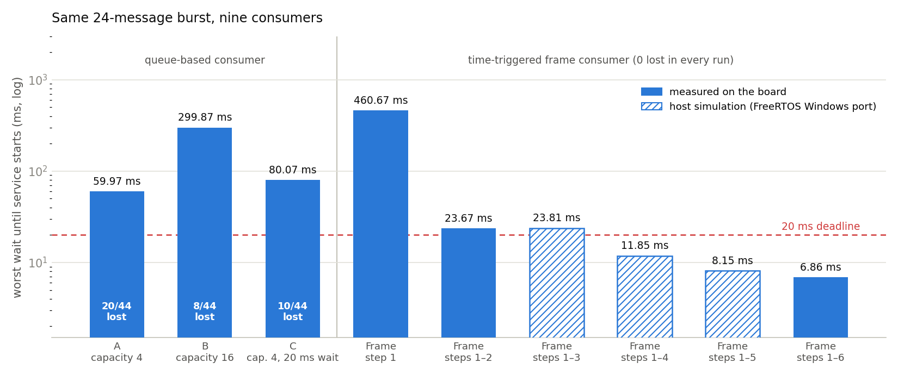</p>

## Bir bakışta

- **Ölçülen:**
  - Her mesaj için üç süre ölçülüyor: gönderme çağrısı, üretimden servisin başlamasına kadar bekleme (`g2r`) ve
    servis süresi.
  - Bütün zaman damgaları tek bir 1 MHz donanım zamanlayıcısından (TIM2) alınıyor.
  - Sonuçlar koşu boyunca RAM'de tutuluyor, koşu bitince UART'tan dökülüyor. Böylece sistem ölçülürken hat
    sessiz kalıyor.
- **Veri:**
  - Kartta 6 taban çizgisi koşusu (3 tüketici × normal / art arda yük) ve 3 çerçeve tüketicisi koşusu var.
  - Ara adımlar gerçek çekirdekli bir host simülasyonunda doğrulandı.
  - Karttaki her koşunun bu depoda bir dökümü ya da SystemView izi var.
- **Bulgu 1: kuyruk art arda yükü emmiyor; neyi kaybedeceğini seçiyor.**
  - Kapasite 4, bekleme yok (A): 44'ün 20'si kayboluyor.
  - Kapasite 16 (B): 8 kayıp, ama kalanlar 300 ms'ye kadar bekliyor.
  - Kapasite 4, 20 ms gönderme beklemesi (C): 10 kayıp; art arda bölümün her ikinci mesajı. İz nedenini gösteriyor:
    üreticinin zaman aşımı ile tüketicinin 20 ms'lik servisi aynı tick'te bitiyor ve önceliği yüksek olan üretici
    önce çalışıyor.
- **Bulgu 2: hiç kaybetmemek zamanında olmak değil.**
  - Kuyruğu her 1 ms'de boşaltan ve kapasiteyi kendisi yöneten tüketici hiçbir koşuda kayıp vermiyor (44/44).
  - Ama aynı 20 ms'lik servisle art arda bölümün borcu sonraki mesajlara 481 ms boyunca sızıyor.
- **Bulgu 3: deadline ayarla değil, tasarımla tutturuluyor.**
  - Servisi 15 baytlık çerçevenin iletim süresi olarak modellemek (651 µs, 1 ms'lik çerçeveye yuvarlanmış) en uzun
    beklemeyi 23,7 ms'ye indiriyor; 4 mesaj geç kalıyor.
  - İki hat, toplu servis ve TIM2 ile fazlanmış çerçeve beklemeyi **6,86 ms**'ye indiriyor; geç kalan yok.
  - Art arda bölümün tamamı ilk mesajından 8,58 ms sonra teslim ediliyor.
  - Normal mesajlar ≈ 0,48 ms bekliyor; faz kaydırmadan önce 988 µs'ydi.
- **Doğrulama:**
  - 2 051 çerçevenin hepsinde çerçeve tick kenarından 498,9–500,1 µs sonra başlıyor; çerçeveler arası
    999,90–1 000,18 µs.
  - Karttaki deadline sayacı, kayıtlarda 20 ms'yi aşan bekleme sayısına eşit (simülasyon).
  - Hata enjeksiyonu: bozuk bir mesaj tutamacı 4 kontrolü kırmızıya çeviriyor; hiçbir şey sessizce kaybolmuyor.

## Deney

**Yük sözleşmesi** (her koşuda aynı):

| Bölüm | Girişimler | Aralık |
|---|---|---|
| Normal | 1–10 | her birinden sonra 100 ms |
| Art arda | 11–34 | aralarında bekleme yok |
| Normal | 35–44 | her birinden sonra 100 ms |

Normal yükte 44 girişimin hepsi 100 ms arayla. Bir mesaj 12 bayt:
- sıra numarası,
- üretim zamanı (TIM2, µs),
- koşu numarası (tüketici başka bir koşunun mesajını reddedebilsin diye).

**Taban çizgisi tüketicileri** (her biri tek bir etkenle ayrılıyor):

| Sürüm | Kuyruk kapasitesi | Gönderme beklemesi | Tüketici |
|---|---|---|---|
| **A** | 4 | 0 | kuyrukta bekler, mesaj başına 20 ms servis |
| **B** | **16** | 0 | aynı |
| **C** | 4 | **20 ms** | aynı |

Öncelikler üçünde de aynı: üretici 2, tüketici 1, komut görevi 3.

**Çerçeve tüketicisi (görev `Arda`).** Her adım bir öncekinin üzerine tek bir değişiklik ekliyor:

| Adım | Değişiklik | Kartta |
|---|---|---|
| 1 | En yüksek öncelikte, her 1 ms'de yoklama yapan zaman tetiklemeli çerçeve görevi. Mesajlar statik tabloda durur, kuyruklarda 1 baytlık tutamaç taşınır. Bütün beklemeler 0 tick; tablo derleme anında boyutlanır. | kayıt 08 |
| 2 | Servis = 15 baytlık ikili çerçevenin (senkron, tip, 12 bayt mesaj, CRC) 230400 8N1'deki iletim süresi: 651 µs, bir çerçeveye yuvarlanmış. Yük değişmez. | kayıt 09 |
| 3 | ARINC 653 tarzı port katmanı: mesaj için queuing port, durum için sampling port. Sağlık izleyici; deadline sayımı (20 ms; geç kalan mesaj servis edilir ve sayılır, atılmaz); servis başı çerçeve başıyla damgalanır. | host simülasyonu |
| 4 | İkinci kurye = ikinci hat. | host simülasyonu |
| 5 | Toplu servis: seferde en çok 3 mesaj, tek hatta arka arkaya; hatlara sırayla dağıtılır. | host simülasyonu |
| 6 | Çerçeve tick'ten değil TIM2'den, SysTick kenarından 500 µs sonra gelir. | kayıt 14 (iz) |

**Her koşuda geçerli kısıtlar:**
- yalnızca statik bellek;
- veri yolundaki her kuyruk ve port işlemi 0 tick bekler;
- iz derlemeye dahil, yani maliyeti her sayının içinde;
- koşu boyunca UART susar (50 ms'lik bekleme, koşu onay satırının önce hattan çıkmasını sağlar).

## Sonuçlar

**Taban çizgisi, kartta ölçüldü** ([`measurements/queue_summary.csv`](measurements/queue_summary.csv)):

| Koşu | Sürüm / yük | Kabul | Kayıp | Kuyruk tepe | En uzun bekleme (g2r) | Başarısız gönderme çağrısı |
|---|---|---:|---|---:|---:|---:|
| 01 | A / normal | 44 | 0 | 1 / 4 | 26 µs | — |
| 02 | B / normal | 44 | 0 | 1 / 16 | 26 µs | — |
| 03 | C / normal | 44 | 0 | 1 / 4 | 26 µs | — |
| 04 | A / art arda | 24 | **20** (15–34) | 4 / 4 | 59,97 ms | 3,1 µs |
| 05 | B / art arda | 36 | **8** (27–34) | 16 / 16 | 299,87 ms | 3,1 µs |
| 06 | C / art arda | 34 | **10** (16, 18, …, 34) | 4 / 4 | 80,07 ms | 19,95 ms (bloklu) |

<p align="center">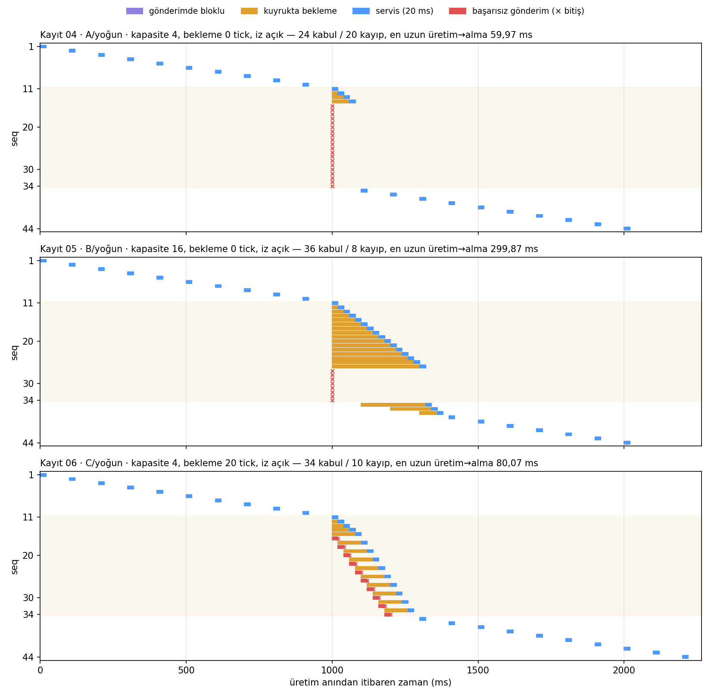</p>

*04–06 koşularının mesaj başına zaman çizelgesi. Mor: gönderme çağrısında bloklu; turuncu: kuyrukta bekleme; mavi:
20 ms servis; kırmızı ×: başarısız gönderim.*

**Aynı art arda yük altında çerçeve tüketicisi:**

| Kayıt | Adımlar | Mesaj başına servis | Kayıp | En uzun bekleme (g2r) | 20 ms'yi aşan | Art arda bölüm teslim | Kaynak |
|---|---|---|---|---:|---|---:|---|
| 08 | 1 | 20 ms | 0 / 44 | 460,67 ms | 28 (12–39) | 480,98 ms | kart dökümü |
| 09 | 1–2 | 651 µs → 1 ms | 0 / 44 | 23,67 ms | 4 (31–34) | 24,98 ms | kart dökümü |
| — | 1–3 | aynı | 0 / 44 | 23,81 ms | 4 (31–34) | — | simülasyon |
| — | 1–4 | + 2. hat | 0 / 44 | 11,85 ms | 0 | — | simülasyon |
| — | 1–5 | + ≤ 3'lük sefer | 0 / 44 | 8,15 ms | 0 | — | simülasyon |
| 14 | 1–6 | + TIM2 fazı | 0 / 44 | **6,86 ms** | **0** | **8,58 ms** | kart izi |

- Kayıt 08'de 35–39 numaralı mesajlar 100 ms arayla gelmelerine rağmen 381 ms'ye kadar bekliyor. Art arda bölümün
  borcu normal trafiğe sızıyor.
- Her adımın sonucu ölçülmeden önce tahmin edildi:
  - Kayıt 08: tahmin 463 ms, ölçüm 460,7 ms.
  - Kayıt 09: tahmin 23,9 ms, ölçüm 23,7 ms.
  - Kayıt 14: tahmin 7,6 ms, ölçüm 6,86 ms. Tahmin, art arda bölümün ilk çerçeveden önce bittiğini varsayıyordu; artık
    bitmiyor ([3. çıkarım](#kayıt-14ten-üç-çıkarım)).

## İzler ne gösteriyor

Aşağıdaki her görüntü, üzerine not düşülmüş bir SystemView ekranı. Harfli kare, aynı harfli notun anlattığı yeri
gösteriyor. Notlar her olayı üreten kodu adıyla anıyor.

### SystemView penceresini okumak

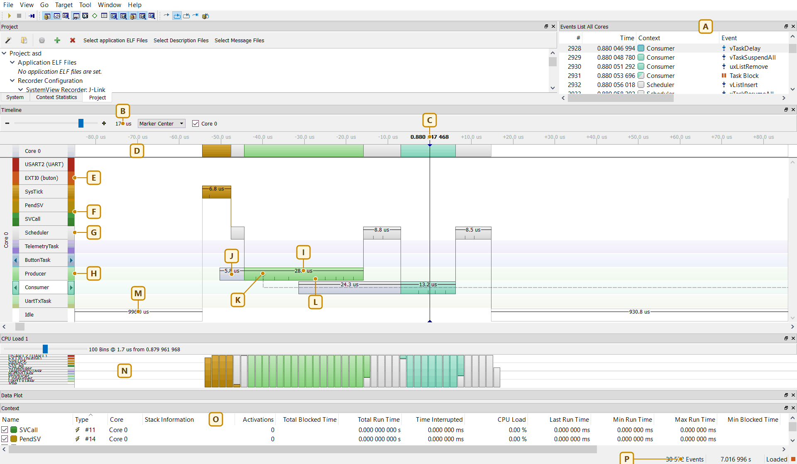

<details><summary>Pencerenin her parçası (A–P)</summary>

- **A · Olay listesi (Events List).** Kaydın her olayı bir satır: sıra numarası, zaman (s), bağlam, olay. Zaman
  çizelgesinde bir yere tıklayınca liste oraya kayar.
- **B · Görünür aralık.** Ekranın solundan sağına geçen süre (burada 171 µs).
- **C · İmleç ve mutlak zaman.** *Marker Center* kipinde imleç ortada; kalın sayı imlecin kayıt başından itibaren
  zamanı. Eksen etiketleri imlece göre ± µs.
- **D · Core 0 satırı.** CPU'nun her an hangi bağlamda olduğunun tek satırlık özeti. Renk = bağlam: SysTick turuncu,
  Producer yeşil, Consumer turkuaz, gri = Scheduler.
- **E · Kesme satırları.** Adlar firmware'in kayıt başında gönderdiği açıklamadan gelir
  (`SEGGER_SYSVIEW_SendSysDesc("I#15=SysTick")`). Numara = 16 + IRQn; USART2'nin IRQn'i 38, yani #54.
- **F · PendSV ve SVCall satırları hep boş.** FreeRTOS portu bu iki kesmenin içinde iz makrosu çağırmaz. PendSV'nin
  işi (bağlam değişimi) *Scheduler* satırında görünür.
- **G · Scheduler satırı.** Bir görevin CPU'yu bırakıp diğerinin başlaması arasındaki süre: *Task Block*'tan sonraki
  liste işlemleri (`vListInsert`, `xTaskResumeAll`) ve PendSV.
- **H · Görev satırları önceliğe göre sıralı.** Adlar `xTaskCreateStatic`'e verilen ad. Aynı anda hazır iki görevden
  üstteki kazanır.
- **I · Çubuğun üstündeki sayı.** O parçanın süresi. Dolu çubuk: çalışma; soluk kutu: Ready'de bekleme; Idle
  satırında boşta geçen süre.
- **J · Soluk kutu = Ready.** Görev hazır ama CPU'yu alamıyor. Başı *Task Ready* olayı (`prvAddTaskToReadyList`,
  tasks.c:289), sonu *Task Run*.
- **K · Gri nokta, kesikli çizgi = mesajın ömrü.** Gri nokta Start Marker (`APP_TRACE_Q_SEND_BEGIN` →
  `SEGGER_SYSVIEW_MarkStart`). Kesikli çizgi kırmızı noktada (MarkStop: `DONE` ya da `SEND_FAIL`) biter ve bittiği
  görevin satırında ilerler. Burada Consumer satırına iniyor: mesaj 2 servis edilecek.
- **L · Alttaki küçük çentikler.** O bağlamda kaydedilen her olay bir çentik: API girişi (`traceENTER_…`), uygulama
  olayı, liste işlemi. Çentik sıklığı çekirdeğin o an ne kadar iş yaptığını gösterir.
- **M · Idle süresi.** Hazır görev yok. 996,0 µs = 1 ms'lik tick periyodundan tick kesmesinin kendi ~3,7 µs'si
  çıkınca kalan.
- **N · CPU Load paneli.** Görünür aralığın 100 dilimde bağlam payları. Bu koşuda CPU %0,55 meşgul.
- **O · Context paneli.** Bağlam başına sayılar: aktivasyon, toplam çalışma süresi, en kısa / en uzun çalışma.
- **P · Durum çubuğu.** Kayıttaki olay sayısı (30 572) ve kaydın süresi (7,017 s).

</details>

### Art arda yük altında taban çizgisi: C sürümü (koşu 06)

Kapasite 4, 20 ms gönderme beklemesi. İz: [`analysis/systemview/C_yogun.SVDat`](analysis/systemview/C_yogun.SVDat).

#### C0 · Koşunun tamamı, 2,15 s

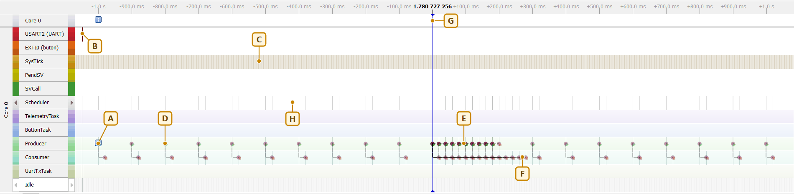

<details><summary>Notlar (A–H)</summary>

- **A · Koşu başı: "i" ikonu ve ilk Start Marker.** `APP_TRACE_Q_RUN_BEGIN` kuyruğa ad verir
  (`SEGGER_SYSVIEW_NameResource` → "MsgQ4") ve "Kosu 6 C/yogun MsgQ4" yazar. Ardından 1. mesajın gri noktası.
- **B · Koşudan ~50 ms önce tek UART izi.** Koşuyu onaylayan QRUN satırı hattan çıkıyor. Üretici ilk gönderimden önce
  50 ms bekliyor ki ölçüm sırasında hat sessiz olsun.
- **C · SysTick satırı tarama gibi.** Her 1 ms'de bir SysTick: bu pencerede ~2 150 kesme, üst üste çiziliyor.
- **D · Normal yük: 100 ms'de bir mesaj.** Producer satırında gri nokta (SEND_BEGIN), 20 ms sonra Consumer satırında
  kırmızı nokta (DONE).
- **E · Art arda bölüm (1,78 s).** 11–34 bekleme olmadan gönderiliyor. Bu ölçekte görünmese de 16, 18, … 34'ün
  çizgileri Producer satırında kalıyor: kaybolanlar onlar.
- **F · Kuyruğun boşalması.** Consumer satırında 20 ms aralıklı kırmızı noktalar: kabul edilen art arda mesajlar tek
  tek servis ediliyor. Sonuncusu (33) 2,06 s'de bitiyor.
- **G · İmleç: art arda bölümün başı** (1,780 727 s). Buraya yakınlaştırınca C3 görünür.
- **H · Scheduler satırındaki ince çizgiler.** Her bağlam değişimi bir çizgi: normal yükte 20 ms'de bir çift, art
  arda bölümde sıklaşıyor.

</details>

#### C1 · Normal bir mesaj: 2 numara gönderiliyor

Üretici 100 ms'lik uykusundan uyanıp 2 numaralı mesajı gönderiyor. Mesaj kuyrukta bekleyen tüketiciyi uyandırıyor,
ama tüketici ancak üretici yeniden uyuyunca çalışabiliyor. Toplam 69 µs; sonra CPU yine boşta.

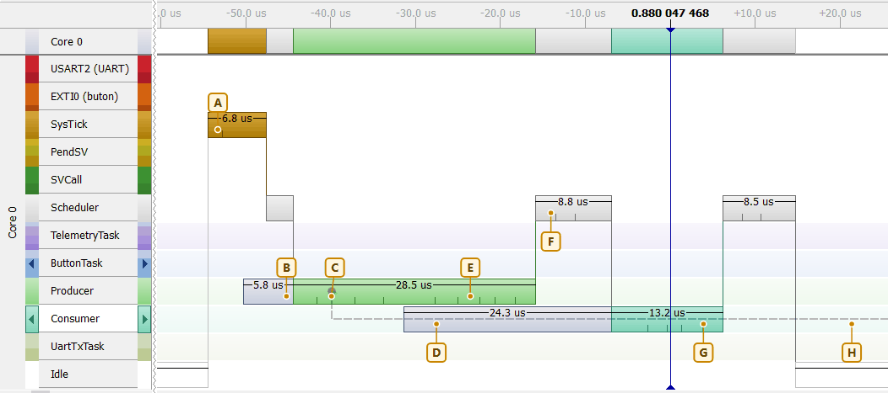

<details><summary>Notlar (A–H)</summary>

- **A · SysTick kutusu "6.8 us".** Kimse uyanmıyorken 3,7 µs. Bu kez üreticiyi gecikme listesinden hazır listesine
  taşıyor ve PendSV istiyor (`xTaskIncrementTick` → `portNVIC_PENDSVSET_BIT`, port.c:455–461).
- **B · Üreticinin soluk kutusu "5.8 us".** Ready; SysTick'in bitmesini ve PendSV'nin bağlamı değiştirmesini bekliyor.
- **C · Gri nokta: Start Marker 1002.** `APP_TRACE_Q_SEND_BEGIN(2)` içindeki `SEGGER_SYSVIEW_MarkStart(1002)`. Kesikli
  çizgi Consumer satırına iniyor: mesaj 2 servis edilecek.
- **D · Tüketicinin soluk kutusu "24.3 us".** Gönderim, kuyrukta bekleyen tüketiciyi Ready yaptı
  (`xTaskRemoveFromEventList`, queue.c:1049). Önceliği 1 < 2: üretici bloklanana kadar bekliyor.
- **E · Üretici çubuğu "28.5 us".** Üreticinin bütün işi: SEND_BEGIN, `xQueueSend`, SEND_OK, `vTaskDelay(100)`.
- **F · Scheduler "8.8 us".** Üreticinin *Task Block*'undan tüketicinin *Task Run*'ına kadar: gecikme listesine
  `vListInsert`, `xTaskResumeAll` ve PendSV.
- **G · Tüketici çubuğu "13.2 us".** RECEIVE 2 ve `vTaskDelay(20)`. Bu çubukta `xQueueReceive` olayı yok: tüketici 80 ms
  önce girdiği çağrının içinden devam ediyor; API olayları yalnızca girişte yazılır.
- **H · Kesikli çizgi sağa sürüyor.** Mesaj 2 artık tüketicide. Çizgi 20 ms sonra DONE 2'nin kırmızı noktasında
  bitecek (C2).

</details>

#### C2 · 20 ms sonra: servis biter, kuyruk boş

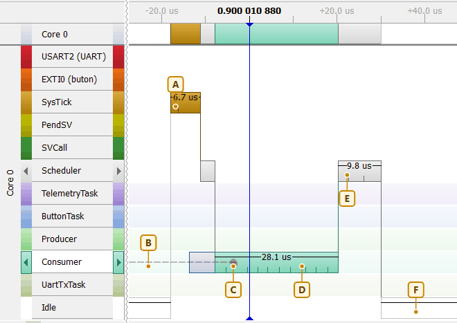

<details><summary>Notlar (A–F)</summary>

- **A · SysTick "6.7 us".** Bu kez uyanan tüketici: 20 tick'lik `vTaskDelay` doldu (tasks.c:4894–4928).
- **B · Soldan gelen kesikli çizgi.** 20 ms önce SEND_BEGIN 2 ile başladı (C1): mesaj 2'nin bütün ömrü.
- **C · Kırmızı nokta: Stop Marker 1002.** `APP_TRACE_Q_DONE(2)` → `SEGGER_SYSVIEW_MarkStop(1002)`. SEND_BEGIN'den buraya
  tam 20,00 ms.
- **D · Tüketici çubuğu "28.1 us".** DONE, `xQueueReceive(…, 250)`, kuyruk boş, `vTaskPlaceOnEventList`.
- **E · Scheduler "9.8 us".** Tüketicinin *Task Block*'undan Idle'a kadar.
- **F · Sonraki 79,96 ms boşta.** İpucu "Idle for 79.958 ms": 100 ms'lik döngünün 20 ms'lik servisten kalanı.

</details>

#### C3 · Art arda bölüm başlıyor: 11–14 geçer, 15'te kuyruk dolar

Üretici 11–14'ü mikrosaniyeler içinde kuyruğa koyuyor; 15'te kuyruk doluyor ve üretici ilk kez kuyrukta bloklanıyor.
Tüketici bu sırada 87,5 µs Ready bekliyor.

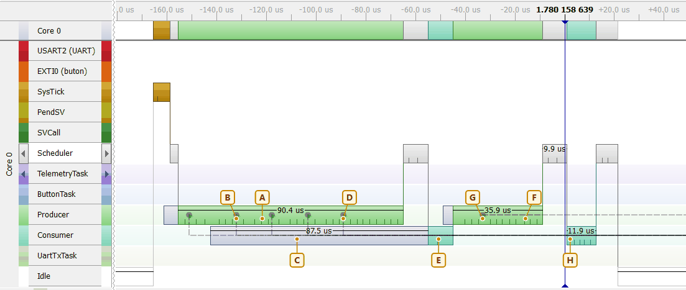

<details><summary>Notlar (A–H)</summary>

- **A · Üretici çubuğu "90.4 us".** 11, 12, 13, 14 art arda gönderiliyor. Üretici hiç bloklanmadığı için daha düşük
  öncelikli tüketici araya giremiyor: çubuk tek parça.
- **B · Dört gri nokta.** 11–14'ün Start Marker'ları. Dördünün çizgisi de Consumer satırına iniyor: dördü de servis
  edilecek.
- **C · Tüketicinin soluk kutusu "87.5 us".** 11 gönderilince Ready oldu ve üretici bloklanana kadar bekledi: koşunun
  en uzun Ready beklemesi.
- **D · Beşinci gri nokta: 15.** Kuyruk 4/4 dolu. Üretici bu gönderimde bloklanıyor:
  `vTaskPlaceOnEventList(&xTasksWaitingToSend, 20)` (queue.c:1126).
- **E · Tüketicinin kısa çubuğu (~10 µs).** `xQueueReceive` içinde 11'i alıyor, yer açılıyor, bekleyen üreticiyi
  uyandırıyor (queue.c:1553) ve üretici hemen araya giriyor.
- **F · Üretici çubuğu "35.9 us".** SEND_OK 15 (bloklandığı çağrının içinden; yeni `xQueueGenericSend` olayı yok) ve
  16'nın denemesi.
- **G · Producer satırında kalan çizgi: 16.** Bu mesajın ömrü üreticide kalıyor ve SEND_FAIL ile bitecek. Ekrana
  bakarak 16'nın kaybolacağını şimdiden okuyabilirsin.
- **H · Tüketici "11.9 us".** RECEIVE 11 (SEND_OK 15'ten sonra) ve `vTaskDelay(20)`. Üreticinin zaman aşımı ile
  tüketicinin servisi aynı tick'ten 20 tick sonraya kuruldu: C4'ün tohumu.

</details>

#### C4 · Aynı tick'te yarış: 16 kaybolur, 17 geçer

20 tick sonra üreticinin zaman aşımı ile tüketicinin servisi aynı SysTick'te bitiyor. Hangisi önce çalışırsa sonucu o
belirliyor: önce üretici çalışıyor ve 16 kayboluyor. Taban çizgisinin asıl karesi bu.

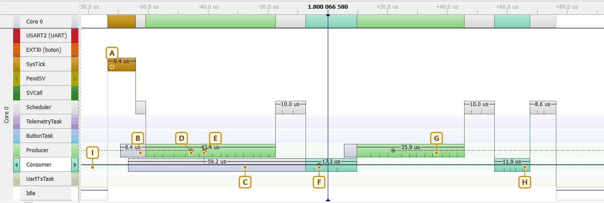

<details><summary>Notlar (A–I)</summary>

- **A · SysTick "9.4 us": iki uyanış.** `xTaskIncrementTick` iki görevi birden hazır listesine taşıyor (iki
  *Task Ready*).
- **B · Üretici "8.4 us" soluk.** İkisi de Ready; önce öncelik 2 olan üretici seçiliyor
  (`taskSELECT_HIGHEST_PRIORITY_TASK`).
- **C · Tüketici "59.2 us" soluk.** Hazır ama bekliyor: DONE 11'i yapamadı, kuyruk hâlâ 4/4.
- **D · Kırmızı nokta: 16 kayboldu.** Stop Marker 1016 = SEND_FAIL 16. `xTaskCheckForTimeOut`: geçen 20 tick ≥
  bekleme 20 → `errQUEUE_FULL`.
- **E · Gri nokta: 17 (çizgisi iniyor).** 17 kabul edilecek; şu an kuyruk dolu, üretici 17'de bloklanıyor.
- **F · Kırmızı nokta: DONE 11.** Hemen ardından `xQueueReceive` 12'yi alıyor, yer açılıyor, bekleyen üretici uyanıyor.
- **G · Üretici "35.9 us".** SEND_OK 17, sonra SEND_BEGIN 18. 18'in çizgisi yine Producer satırında kalıyor: sonraki
  yarışta o da kaybolacak.
- **H · Tüketici "11.9 us".** RECEIVE 12 (gecikme 20 097 µs) ve `vTaskDelay(20)`. Aynı kurulum yeniden oluştu.
- **I · Consumer satırındaki koyu çizgi.** Üst üste binmiş ömürler: kuyrukta bekleyen 12, 13, 14, 15; hepsi tüketicide
  bitecek.

</details>

#### C5 · Son yarış: 34 kaybolur, art arda bölüm biter

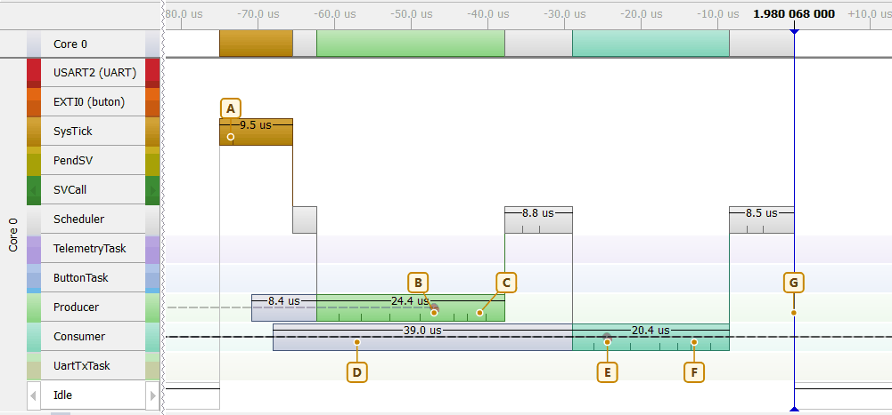

<details><summary>Notlar (A–G)</summary>

- **A · SysTick "9.5 us".** Yine iki *Task Ready*: onuncu ve son yarış.
- **B · Kırmızı nokta: 34 kayboldu.** Stop Marker 1034 = SEND_FAIL 34, art arda bölümün son girişimi.
- **C · Üretici "24.4 us": gri nokta yok.** SEND_FAIL 34'ten sonra yeni SEND_BEGIN yok: 100 ms'lik ara başlıyor,
  üretici uyuyor.
- **D · Tüketici "39.0 us" soluk.** Üretici bloklanana kadar Ready bekliyor.
- **E · Kırmızı nokta: DONE 25.** Kuyruktan çıkan sonraki mesaj 27: 26 hiç kuyruğa girmemişti.
- **F · Tüketici "20.4 us".** RECEIVE 27 ve `vTaskDelay(20)`. Gönderici bekleyen yok: `xQueueReceive` kimseyi
  uyandırmıyor.
- **G · Producer satırında çizgi kalmadı.** Bekleyen başarısız gönderim yok. Consumer satırındaki koyu çizgi kuyrukta
  kalan 27, 29, 31, 33.

</details>

#### C6 · Boşalma: üretici uyurken kuyruk boşalır

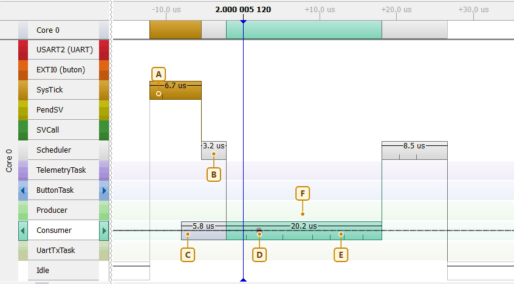

<details><summary>Notlar (A–F)</summary>

- **A · SysTick "6.7 us".** Tek uyanış: yalnızca tüketici.
- **B · Scheduler "3.2 us".** PendSV'nin bağlam değişimi; bu ölçekte etiketi sığmış.
- **C · Tüketici "5.8 us" soluk.** *Task Ready* → *Task Run*.
- **D · Kırmızı nokta: DONE 27.**
- **E · Tüketici "20.2 us".** RECEIVE 29: kuyrukta mesaj var, `xQueueReceive` bloklanmadan dönüyor; sonra
  `vTaskDelay(20)`.
- **F · Producer satırı boş.** Üretici 34'ten sonra uyuyor; 2,08 s'de 35 ile dönecek. Consumer satırındaki koyu çizgi
  31 ve 33.

</details>

#### C7 · Koşu sonu: DONE 44, döküm UART'tan çıkıyor

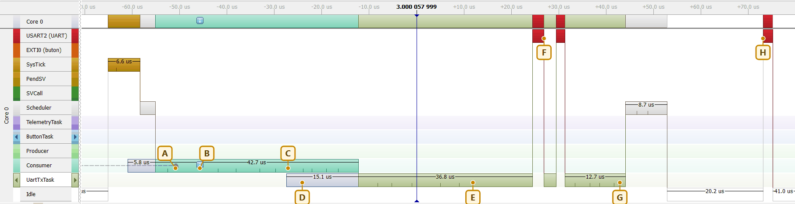

<details><summary>Notlar (A–H)</summary>

- **A · Kırmızı nokta: DONE 44.** Son mesajın ömrü kapandı.
- **B · "i" ikonu: "Kosu 6 bitti".** `APP_TRACE_Q_RUN_END` → `SEGGER_SYSVIEW_Print`.
- **C · Tüketici "42.7 us": Task Block yok.** `ulTaskNotifyTake(pdTRUE, portMAX_DELAY)` görevi gecikme listesine değil
  askıdaki görevler listesine koyar (tasks.c:8717–8722).
- **D · UartTxTask "15.1 us" soluk.** Döküm isteği kuyruğa konunca Ready oldu. Önceliği tüketiciye eşit: tüketici
  bloklanınca çalıştı.
- **E · UartTxTask "36.8 us".** Döküm isteğini alıyor, hattı sahipleniyor, ilk kayıt satırını kodluyor ve aktarımı
  başlatıyor.
- **F · İlk iki USART2 kesmesi.** 5 µs arayla: veri yazmacı boş, ilk bayt hemen kaydırma yazmacına geçiyor, ikinci
  bayt arkasından.
- **G · UartTxTask "12.7 us".** Satırın bitmesini bekliyor (`xTaskNotifyWait`, 50 ms zaman aşımı) ve bloklanıyor.
- **H · Sonraki kesme ~43 µs sonra.** 230400 baud'da bir bayt = 10 bit ≈ 43,4 µs. Koşu boyunca ilk UART kesmesi:
  ölçüm sırasında hat sessizdi.

</details>

### Aynı art arda yük altında çerçeve tüketicisi (kayıt 14)

Adım 1–6. İz: [`analysis/systemview/14Arda_yogun_2_v2.SVDat`](analysis/systemview/14Arda_yogun_2_v2.SVDat). Bu izde üç
yeni şey var:

- **ISR 44 = TIM2, çerçeve saati.**
  - İstisna numarası 16 + IRQn; TIM2'nin IRQn'i 28.
  - Firmware'in sistem açıklamasında TIM2'nin adı yok, bu yüzden SystemView numarayı yazıyor.
  - Her 1 ms'de, tick kenarından 500 µs sonra gelir ve çerçeve görevini uyandırır (`frame_timer.c`).
- **`Arda` = çerçeve görevi.**
  - Önceliği en yüksek (5) ve o seviyede tek görev; onu yalnızca kesmeler geciktirebilir.
  - Porttan alır, kuryelere (hatlara) verir, teslim eder.
- **Consumer satırı boş kalıyor.**
  - O görev taban çizgisinin tüketicisi.
  - Koşu başında üretici yalnızca bu koşunun tüketicisini uyandırıyor (`s_run_consumer = arda_task()`).
  - Taban tüketicisi kendi `ulTaskNotifyTake`'inde bekliyor ve tek olay yazmıyor.

#### F1 · Koşu başlıyor: komut, kurulum, çerçeve saati

Yer istasyonunun `'Q' 0x14` komutu geliyor. Ardından sırasıyla:
- TelemetryTask koşuyu kuruyor,
- üretici çerçeve görevini uyandırıyor,
- çerçeve görevi saatini kuruyor,
- UartTxTask koşu onay satırını gönderiyor.

Öncelik sırası ekrandan okunuyor: üretici (2), TelemetryTask (3) bitmeden çalışamıyor; UartTxTask (1) de üretici
bitmeden. Çerçeve görevi (5) ise uyandığı an araya giriyor.

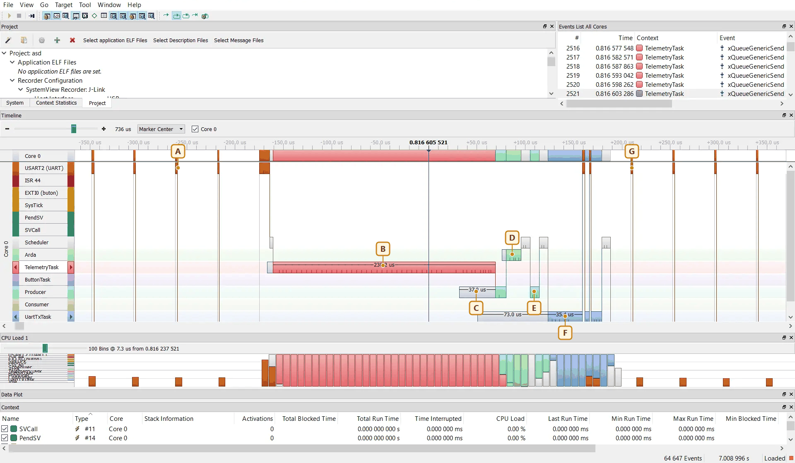

<details><summary>Notlar (A–G)</summary>

- **A · Beş USART2 kesmesi, 43 µs arayla.** Komut çerçevesi (`AA 55 'Q' 0x14` + sağlama) bayt bayt geliyor. Sonuncusu
  çerçeveyi tamamlıyor ve TelemetryTask'ı uyandırıyor.
- **B · TelemetryTask "230.2 us".** `queue_exp_start` → `arda_run_begin` → `port_reset`: 32 tutamacın hepsi tek tek boş
  kuyruğuna konuyor. Olay listesindeki art arda `xQueueGenericSend`'ler bunlar, ~5,2 µs arayla: 32 × 5,2 ≈ 166 µs.
- **C · Üreticinin soluk kutusu "37.0 us".** TelemetryTask bildirim verince Ready oldu, ama önceliği 2 < 3.
- **D · Çerçeve görevinin ilk kısa çalışması.**
  - Üreticinin `xTaskNotifyGive(s_run_consumer)`'u onu uyandırıyor; görev hemen araya giriyor.
  - `frame_timer_start` son tick kenarını SysTick sayacından hesaplıyor ve ilk çerçeveyi kenar + 500 µs'ye kuruyor.
  - Sonra TIM2 kesmesini açıp çerçeve beklemeye geçiyor.
- **E · Üreticinin ikinci parçası.** `vTaskDelay(QEXP_SETTLE_MS)` = 50 ms: onay satırı hattan çıksın, ölçüm başladığında
  hat sessiz olsun.
- **F · UartTxTask: 73,0 µs Ready, 35,4 µs çalışma.** En düşük öncelik (1). Onay satırını kodluyor ve ilk baytları
  gönderiyor.
- **G · Sonraki kesmeler: onay satırı.** Yine 43 µs arayla, bu kez gönderim. 64 baytlık satır ~2,8 ms sürüyor; F2 ve
  F3'te hâlâ gidiyor.

</details>

#### F2 · İlk çerçeve: TIM2 çerçeve görevini uyandırıyor

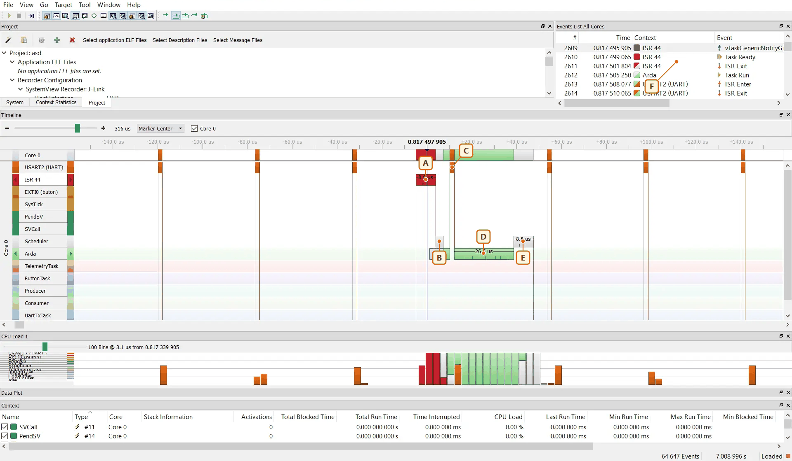

<details><summary>Notlar (A–F)</summary>

- **A · ISR 44 "8.9 us" = TIM2.** `frame_timer_isr` karşılaştırma bayrağını siliyor ve `CCR1`'i 1 000 µs ileri alıyor.
  `vTaskNotifyGiveIndexedFromISR(…, 1, …)` ile çerçeve görevini Ready yapıyor ve çıkışta bağlam değişimi istiyor.
- **B · Scheduler (gri).** PendSV'nin Idle'dan çerçeve görevine geçişi.
- **C · Çerçeve görevi çalışırken bir USART2 kesmesi.** Kesmeler bütün görevlerden önceliklidir; en yüksek öncelikli
  görev de bekler. Onay satırının bir baytı; birkaç µs'si çerçeveye giriyor.
- **D · `Arda` "26.5 us": boş çerçeve.** Sırasıyla:
  - `complete_trips`: yolda kurye yok;
  - `intake`: port boş, `port_take` hemen dönüyor;
  - `dispatch`: verilecek iş yok;
  - `write_status`: her çerçevede çalışır;
  - sayaçlar güncelleniyor.

  Sonra görev `frame_timer_wait`'te bloklanıyor.
- **E · Scheduler "8.8 us".** Çerçeve görevinin *Task Block*'undan Idle'a.
- **F · Olay listesi.** ISR 44 → `vTaskGenericNotifyGiveFromISR` → *Task Ready* (Arda) → ISR Exit → *Task Run* (Arda) →
  USART2 ISR Enter/Exit.

</details>

#### F3 · Onay satırının sonu ve boş bir çerçeve

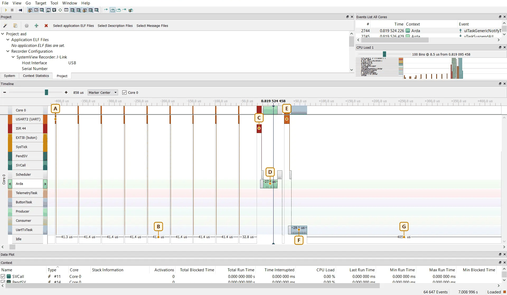

<details><summary>Notlar (A–G)</summary>

- **A · Her bayt bir USART2 kesmesi.** Veri yazmacı boşaldı, sıradaki bayt yazılıyor. 43,4 µs'de bir.
- **B · Idle "41.4 us".** İki bayt arası CPU boşta: 43,4 µs'lik bayt süresinden kesmenin ~2 µs'si çıkınca.
- **C · ISR 44: tick + 500 µs.** Çerçeve, UART trafiğinden bağımsız olarak zamanında geliyor.
- **D · `Arda` "27.0 us".** Yine boş çerçeve: üretici ilk mesajdan önce 50 ms bekliyor.
- **E · Daha uzun bir USART2 kesmesi.** Son bayt da çıktı; kesme UartTxTask'a "satır bitti" diyor.
- **F · UartTxTask "29.1 us".** Satır bitti, kuyrukta başka satır yok. Koşu bitene kadar hatta başka satır çıkmayacak.
- **G · Idle "405.1 us".** Sonraki tick'e kadar hiçbir şey yok.

</details>

#### F4 · 1. mesaj: tick'te üretiliyor, yarım çerçeve sonra alınıyor

Üretici tick kenarında gönderiyor; çerçeve görevi mesajı 500 µs sonraki çerçevede alıp seferi başlatıyor. Sefer bir
çerçeve sürüyor (hatta 651 µs, 1 ms'ye yuvarlanmış), teslim bir sonraki çerçevede. Servis başına kadar bekleme ≈ 0,5
ms; 6. adımdan önce 988 µs'ydi.

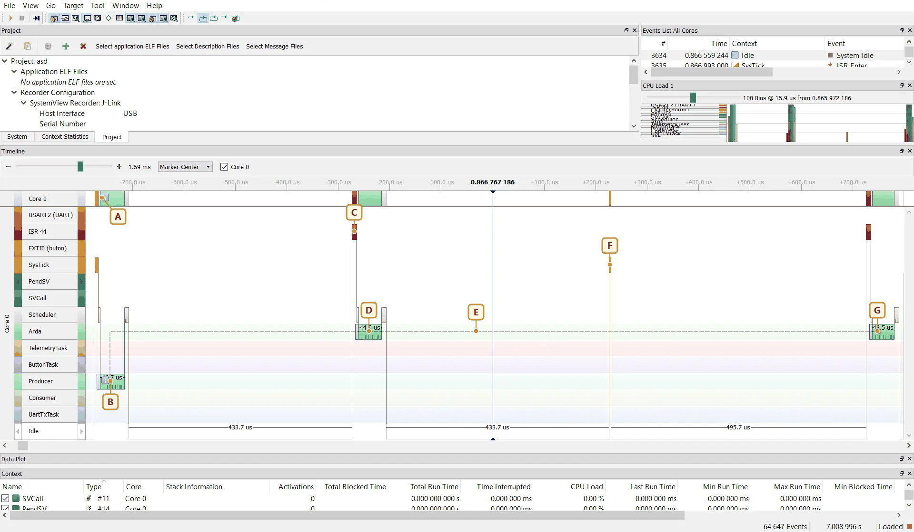

<details><summary>Notlar (A–G)</summary>

- **A · "i" ikonu: koşu başladı.** `APP_TRACE_Q_RUN_BEGIN` koşuyu yazıyor, ilk gönderimden hemen önce.
- **B · Gri nokta: SEND_BEGIN 1.** Üreticinin çubuğu (~45 µs):
  - durum portunu okuma (`port_read`);
  - `port_send`: boş bir tutamaç alma, mesajı slota kopyalama, tutamacı ready kuyruğuna koyma;
  - iz olayları.
- **C · ISR 44: T + 500 µs.** Tick'ten yarım çerçeve sonra; üreticinin işi çoktan bitmiş.
- **D · `Arda` "44.9 us": alma ve sefer başlangıcı.**
  - `intake`: `port_take` mesaj 1'i veriyor (RECEIVE olayı).
  - `dispatch`: kurye 0 yola çıkıyor; servis başı bu çerçevenin başı.
  - Boş çerçeveden ~18 µs uzun. Farkı izlenen çekirdek çağrıları ve iz olayları oluşturuyor.
- **E · Çerçeve görevinin satırındaki kesikli çizgi.** Mesaj 1'in ömrü: çerçeve görevinde sürüyor, orada bitecek.
- **F · SysTick (T + 1 ms).** Kimse uyanmıyor: üretici 100 ms uykuda, çerçeve görevi TIM2'yi bekliyor.
- **G · Kırmızı nokta: DONE 1.** Sefer bir çerçeve sürdü. `complete_trips` teslim ediyor (Stop Marker) ve tutamacı
  porta geri veriyor (`port_release`). Çerçeve görevi 42,5 µs.

</details>

#### F5 · 3. mesajdan önce: boş çerçeve, sonra gönderim

Çerçeve görevi mesaj olsun olmasın her 1 ms'de çalışıyor: zaman tetiklemeli.

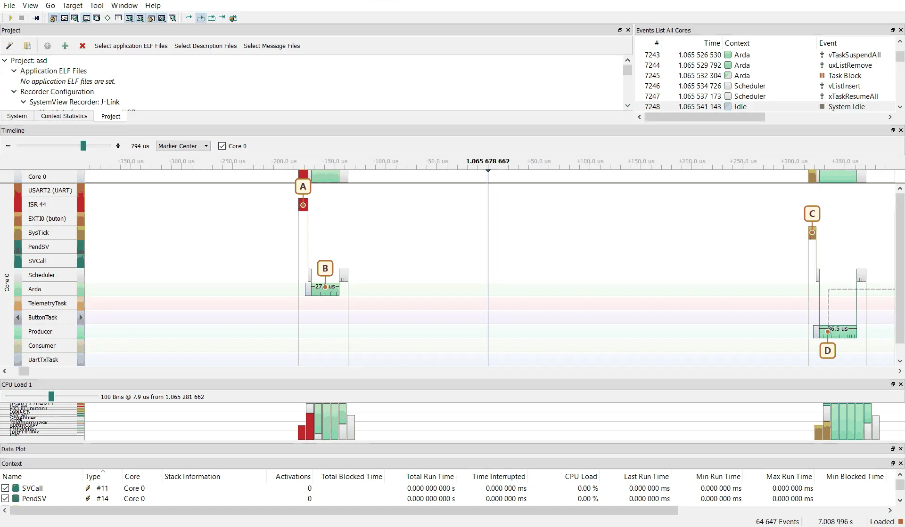

<details><summary>Notlar (A–D)</summary>

- **A · ISR 44.** Tick kenarından 500 µs sonra, mesaj olsun olmasın.
- **B · `Arda` "27.0 us": boş çerçeve.** Olay listesinin son satırları: `vTaskSuspendAll`, `uxListRemove`, *Task Block*.
  Görev `ulTaskNotifyTakeIndexed` içinde bloklanıyor; sonraki çerçeveyi bekliyor.
- **C · SysTick.** Üreticinin 100 ms'lik uykusu bitiyor.
- **D · Üretici "36.5 us" ve gri nokta.** SEND_BEGIN 3. Çizgisi çerçeve görevinin satırına çıkacak (F6).

</details>

#### F6 · 3. mesajın yolculuğu ve faz: 499,9 µs

Olay listesi fazı mikrosaniye düzeyinde veriyor: SysTick 1,066 993 000 s'de, ISR 44 1,067 492 917 s'de.

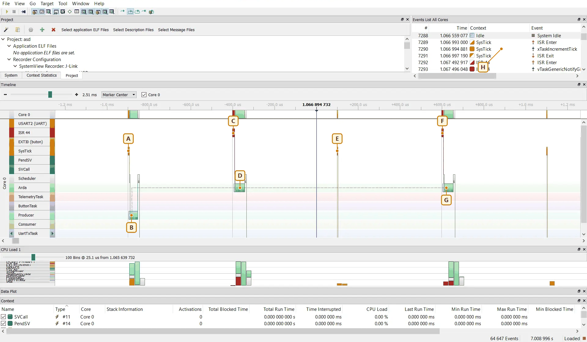

<details><summary>Notlar (A–H)</summary>

- **A · SysTick: T.** Üretici uyanıyor.
- **B · Üretici ve gri nokta.** SEND_BEGIN 3; çizgisi çerçeve görevinin satırına çıkıyor.
- **C · ISR 44: T + 500 µs.** Çerçeve görevini uyandırıyor.
- **D · Çerçeve görevi: alır, sefer başlar.** Mesaj 3 porttan çıkıp kurye 0'a veriliyor: bekleme ≈ 0,5 ms.
- **E · SysTick: T + 1 ms.** Boş tick, yalnızca sayaç artıyor.
- **F · ISR 44: T + 1,5 ms.** Seferin süresi doldu.
- **G · Kırmızı nokta: DONE 3.** Teslim ve `port_release`.
- **H · Olay listesi: faz.**
  - Olay 7289: SysTick ISR Enter, 1,066 993 000 s.
  - Olay 7292: ISR 44 Enter, 1,067 492 917 s.
  - Fark 499,917 µs; ayar 500 µs (`ARDA_FRAME_PHASE_US`).
  - Kaydın tamamında faz 498,9–500,1 µs arasında kalıyor. TIM2 1 µs adımla sayıyor; iki kesmenin girişi de birkaç
    işlemci çevrimi sonra damgalanıyor.

</details>

#### F7 · Art arda bölüm: çerçeve üreticiyi yarıda kesiyor

11–34 bekleme olmadan gönderiliyor. İz açıkken her girişim ~27 µs sürüyor, bu yüzden bölüm artık 500 µs'ye sığmıyor.
Tick + 500 µs'deki çerçeve üreticiyi 18. girişimden sonra kesiyor; kalan 6 girişim çerçeveden sonra geliyor. Hiçbir
gönderim başarısız değil: 24 çizginin hepsi çerçeve görevinin satırına çıkıyor.

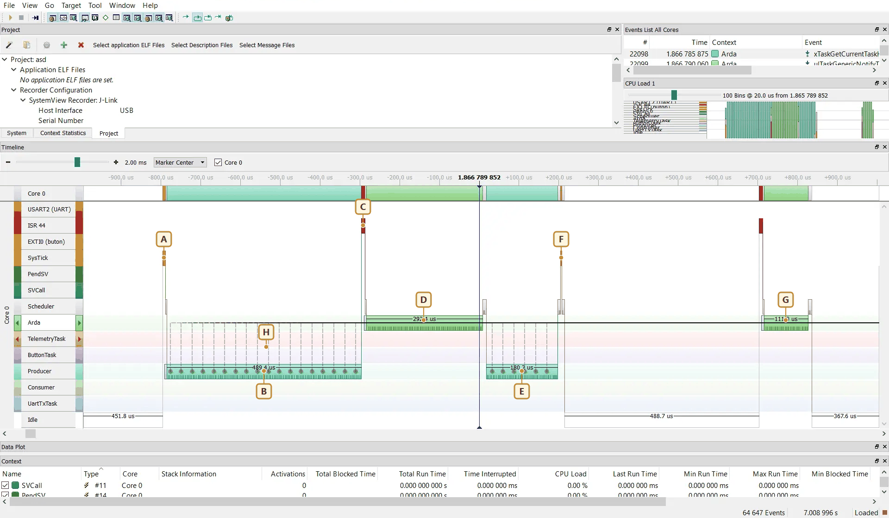

<details><summary>Notlar (A–H)</summary>

- **A · SysTick: T.** Üretici 10. mesajdan sonraki 100 ms'lik uykusundan uyanıyor; art arda bölüm başlıyor.
- **B · Üretici "489.4 us": 18 gri nokta.** 11–28, ~27 µs arayla. Her girişimde durum portu okunuyor, `port_send`'in iki
  kuyruk işlemi yapılıyor ve iz olayları yazılıyor.
- **C · ISR 44: T + 500 µs.** TIM2 kesmesi üreticinin ortasına düşüyor. Çerçeve görevi (5) > üretici (2): üretici
  Ready'de bekliyor.
- **D · `Arda` "292.4 us".** Koşunun en uzun çerçevesi.
  - `intake` 18 mesajı porttan alıyor (her biri ~13 µs).
  - `dispatch` her hatta 3 mesaj veriyor, sırayla dağıtarak: 11 → hat 0, 12 → hat 1, 13 → hat 0 …
- **E · Üretici "180.2 us": kalan 6.** 29–34, tick'ten 0,8–1,0 ms sonra üretiliyor; bir sonraki çerçevede alınacaklar.
- **F · SysTick: T + 1 ms.** Boş tick.
- **G · `Arda` "111.0 us".** Kalan 6 mesajı alıyor (her biri ~14 µs). İki kurye de yolda (3 mesajlık sefer 2 çerçeve
  sürer): yeni sefer yok.
- **H · Bütün çizgiler çerçeve görevinin satırına çıkıyor.** 24 mesajın hepsi kabul edildi; hiçbiri Producer
  satırında kalmadı. Taban çizgisinde (C3–C5) kaybolanlarınki orada kalıyordu.

</details>

#### F8 · Art arda bölümden sonra: 2 ms'de bir ağır çerçeve

3 mesajlık sefer 1 953 µs = 2 çerçeve sürüyor. İki hat birlikte çıktığı için her 2 ms'de bir ağır çerçeve var: 6
teslim (2 hat × 3) ve 6 yeni sefer. Aradaki çerçeve hafif. İki görüntü 2,002 ms arayla neredeyse aynı.

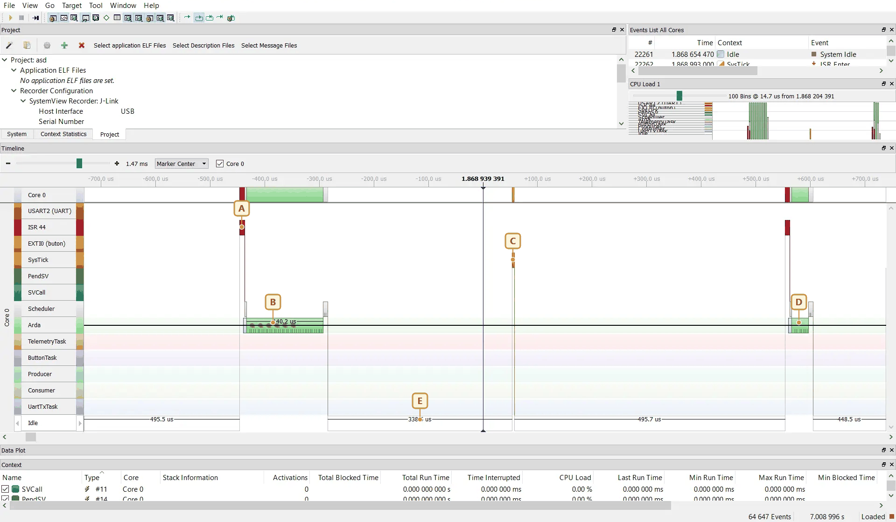

<details><summary>Notlar (A–E)</summary>

- **A · ISR 44: T + 2,5 ms.** İlk iki seferin süresi doldu.
- **B · `Arda` "140.2 us": 6 kırmızı nokta.** `complete_trips` iki kuryeyi birlikte bitiriyor: konum sırasıyla 11, 12,
  13, 14, 15, 16 teslim (Stop Marker'lar) ve 6 `port_release`. Ardından `dispatch` 17–22'yi yola çıkarıyor.
- **C · SysTick: boş.** Tick yalnızca sayacı artırıyor.
- **D · Hafif çerçeve (~31 µs).** Kuryeler yolda, bekleyen mesaj var ama boş kurye yok: yalnızca kontrol ve durum
  yazma.
- **E · Idle "338.5 us".** Ağır çerçeveden sonra kalan boşluk; hafif çerçeveden sonra 448,5 µs.

</details>

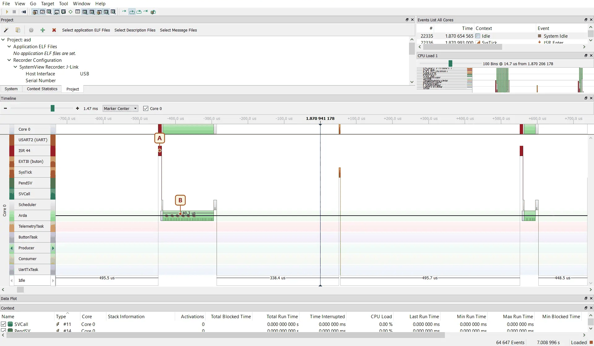

<details><summary>Notlar (A–B)</summary>

- **A · ISR 44: T + 4,5 ms.** Tam 2 ms sonra aynı desen.
- **B · `Arda` "140.3 us": 17–22 teslim, 23–28 yola.** Öncekiyle 0,1 µs içinde aynı: bir çerçevenin işi, o çerçevedeki
  mesaj sayısıyla belli.

</details>

#### F9 · 10 ms'lik genel bakış: 24 mesaj ~8,5 ms'de teslim

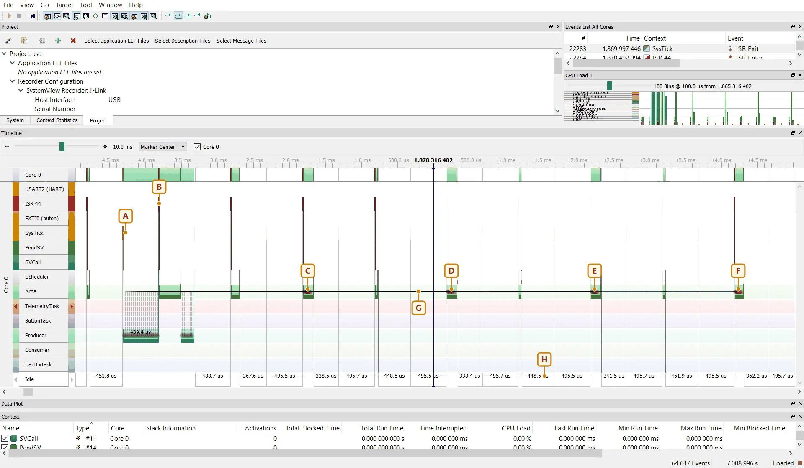

<details><summary>Notlar (A–H)</summary>

- **A · SysTick: T, art arda bölüm.** Üreticinin iki bloğu (489,4 + 180,2 µs).
- **B · İlk çerçeve (292 µs).** 18'ini alıp 6'sını yola çıkaran çerçeve (F7).
- **C · T + 2,5 ms: 11–16 teslim.** Ağır çerçeve: 6 teslim, 6 yeni sefer.
- **D · T + 4,5 ms: 17–22.**
- **E · T + 6,5 ms: 23–28.** Son 6 mesaj (29–34) yola çıkıyor.
- **F · T + 8,5 ms: 29–34.** Son teslimler; bundan sonra hiçbir yerde bekleyen yok.
- **G · Çerçeve görevinin satırındaki kalın çizgi.** Üst üste binmiş 24 ömür; ağır çerçevelerde altışar altışar bitiyor.
- **H · Idle'lar dönüşümlü.** 495,5 µs: tick'ten çerçeveye; 338–362 µs: ağır çerçeveden sonra; 448–452 µs: hafif
  çerçeveden sonra.

</details>

#### F10 · Son mesaj (44) ve koşunun sonu

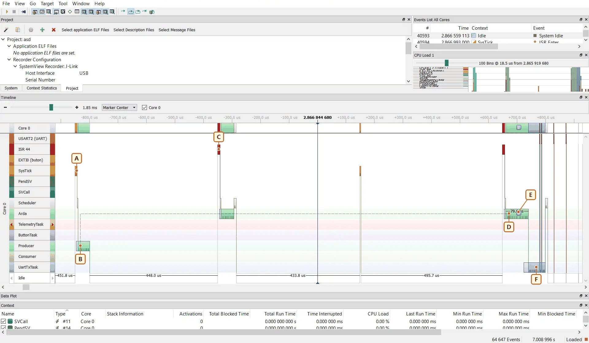

<details><summary>Notlar (A–F)</summary>

- **A · SysTick: T.** Üretici son kez uyanıyor.
- **B · SEND_BEGIN 44: son girişim.** Arkasından bekleme yok; üretici döngüden çıkıp `s_producer_done` yazıyor.
- **C · ISR 44: T + 500 µs.** Çerçeve görevi 44'ü alıp seferi başlatıyor.
- **D · Kırmızı nokta: DONE 44.** Son teslim.
- **E · "i" ikonu: "Kosu … bitti".** `qexp_consumer_finished()` ve `all_idle()` doğru, döngü bitiyor. Sırasıyla:
  - `frame_timer_stop`: TIM2 kesmesi kapanıyor;
  - tutamaç sızıntısı sayılıyor;
  - `qexp_finish_run` → `APP_TRACE_Q_RUN_END` ve döküm isteği.

  Çerçeve bu yüzden 79 µs sürüyor.
- **F · UartTxTask: döküm başlıyor.** Kayıt, sayaç ve son satırları; bayt başına bir USART2 kesmesi. Çerçeve saati
  bundan sonra kapalı.

</details>

#### Kayıt 14'ten üç çıkarım

1. **Dolu çerçeve bedava değil.**
   - Boş çerçeve 26,5–27,0 µs; mesaj alan ya da teslim eden çerçeve 42,5–44,9 µs.
   - İz açıkken mesaj başına ~13–18 µs.
   - Değişmeyen şey sınır: bir çerçevenin işi içindeki mesaj sayısıyla belli ve port en çok 32 mesaj tutuyor.
2. **Art arda çerçeve bütçeye yakın.**
   - 292,4 µs; çerçeve işi bütçesi 300 µs (iz açık).
   - Mesaj başına ~13 µs ile, 32 slotun hepsini bir anda alan bir çerçeve ~450 µs sürerdi.
   - Bu yük bir çerçeveye en çok 18 mesaj getiriyor. Çerçeve başına mesaj sınırı (BUT-04) artık bu izden
     hesaplanabilir.
3. **Art arda bölüm artık çerçeveye bölünüyor.**
   - Port katmanı ve durum okuması iz açıkken girişim başına ~27 µs tutuyor; 24 girişim ~670 µs, yani 500 µs'lik
     fazdan uzun.
   - Çerçeve bölümü 18. girişimden sonra kesiyor.
   - Son mesajlar daha geç üretilip daha az bekliyor. En uzun bekleme 6,86 ms (mesaj 33). Tahmin 7,6 ms'ydi, çünkü
     art arda bölümün ilk çerçeveden önce bittiğini varsayıyordu.

## Sistem

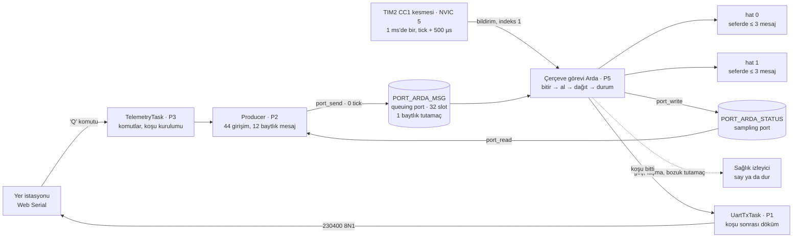

**Çerçeve sırası** (`arda.c`), her çerçevede aynı:

| Adım | Fonksiyon | İş |
|---|---|---|
| 1 | `complete_trips` | Süresi dolan seferler biter: `DONE`, tutamaçlar konum sırasıyla porta döner. |
| 2 | `intake` | Mesaj portu 0 tick'lik `port_take`'lerle gelen kutusuna boşaltılır. |
| 3 | `dispatch` | Boş kuryeler bekleyenlerden en çok 3'er mesaj alır, hatlara sırayla dağıtılır. Seferdeki *k*. mesaj çerçeve başından *k* × 651 µs sonra başlar; üretimden 20 ms sonra başlayan deadline kaçırmış sayılır. |
| 4 | `write_status` | Birikme, bekleyen en eski mesajın yaşı ve deadline sayısı sampling porta yazılır. |

**Taban çizgisi yolu** (A/B/C): Producer → FreeRTOS kuyruğu (kapasite 4 ya da 16) → `Consumer` (P1); servis 20 ms'lik
`vTaskDelay`. Üretici, yük ve kayıtlar iki yolda da aynı; koşu başına yalnızca tüketici seçiliyor.

## Mühendislik öne çıkanlar

- **Donanımla fazlanmış çerçeve.**
  - Çerçeve TIM2'nin karşılaştırma kanalından geliyor; bu, her ölçümü damgalayan 1 µs'lik sayacın ta kendisi.
  - İlk karşılaştırma, SysTick sayacından hesaplanan son tick kenarının 500 µs sonrasına kuruluyor.
  - SysTick ve TIM2 aynı PLL'den beslendiği için faz kaymıyor.
  - Kesme karşılaştırmayı 1 000 µs ileri alıp göreve ayrı bir bildirim indeksinden haber veriyor.
  - Geç kalan bir kesme, geçen her çerçeve için bir bildirim veriyor; görev bunları kaçırılmış çerçeve sayıyor.
- **ARINC 653 tarzı port katmanı.**
  - Portlar tek bir tabloda (`port_config.c`) tanımlı: tür, mesaj boyu, kapasite, tazeleme süresi, depolama.
  - Her portun açılışta bağlanan tek yazarı ve tek okuyucusu var; başka bir görev çağırırsa sistem duruyor.
  - Queuing port tutamaçları BOŞ → KUYRUKTA → ALINDI → BOŞ yolunu izliyor; beklenmeyen bir geçiş bildiriliyor, asla
    kullanılmıyor.
  - Sampling port değerin yaşını, geçerliliğini ve okuyucunun kaçırdığı güncelleme sayısını veriyor.
- **Atmadan deadline sayımı.** Geç başlayan mesaj yine servis ediliyor. Ama sayılıyor ve tepkileri bir tabloda tanımlı
  sağlık izleyiciye bildiriliyor: say ya da tasarım hatasında dur.
- **Kapasite derleme anında kanıtlanıyor.** `_Static_assert`'ler yük sözleşmesini denetliyor:
  - normal mesajlar arası en az bir sefer süresi var;
  - port art arda bölümü ve payı alıyor;
  - art arda bölümden sonra servis gelişten hızlı;
  - sefer çerçevenin tam katı;
  - kurye sayısı boştaki UART sayısını aşmıyor.

  Yük değişirse derleme duruyor.
- **Dürüst toplu servis.**
  - Kurye yükünün dolmasını beklemiyor.
  - Seferdeki *k*. mesajın servis başı sefer başından *k* × 651 µs sonrasına damgalanıyor.
  - Sırayla dağıtım, iki hattaki servis başlarını sıra numarası düzeninde tutuyor. Alıcı iki hattı en çok bir mesajlık
    tamponla birleştirebiliyor.
- **CCM yerleşimiyle statik bellek.**
  - Yığınlar, TCB'ler ve çerçeve görevinin durumu çekirdeğe bağlı RAM'de (CCM).
  - Ana yığın CCM'in tabanında: taşma veriyi sessizce bozmuyor, HardFault üretiyor.
  - Bir DMA'nın okuyabileceği her şey ana SRAM'de.
  - Kullanılan RAM 37 795 B (ana SRAM %19,4, CCM %19,0); iz kapalıyken 19 706 B.
- **Kendini tarif eden dökümler.** Yapılandırma değerleri (kurye sayısı, sefer boyu, çerçeve fazı) sayaçlarla birlikte
  dökülüyor. Yanlış firmware ile alınan koşu yanlış dosyalanmıyor; kontrollerde kırmızı çıkıyor.
- **Ölçüm bütünlüğü.**
  - İz olayları ölçülen aralıkların dışında: SEND_BEGIN gönderme çağrısının zaman damgasından önce, SEND_OK sonra
    yazılıyor.
  - Koşunun sonuçları RAM'de kalıyor ve UART'tan ancak koşu bitince çıkıyor; sistem ölçülürken hat sessiz.
- **Hedef dışında test.**
  - Gerçek `queue_exp.c`, `arda.c` ve `port_layer.c`, FreeRTOS'un Windows portunda deneyin tamamını koşturan bir
    simülasyonda çalışıyor.
  - Protokol testi her döküm satırını denetliyor.
  - Hata enjeksiyonu, bozuk bir tutamacın sessizce kaybolamayacağını gösteriyor.

## Ölçerek bulunan hatalar ve sürprizler

1. **Servis başı geç damgalanıyordu.** Kayıt 08 ve 09'da mesaj 11'in servisi 142 µs kısa görünüyordu.
   - Neden: sefer başı, art arda bölümün ~133 µs'lik alımından sonra, dağıtım anında damgalanıyordu.
   - Düzeltme: çerçevenin başlangıç anıyla damgalamak.
2. **"Kayıp yok" kontrolü servis tarafındaki kaybı görmüyordu.** Hata enjeksiyonu (bozuk tutamaç), kabul edilmiş ama
   hiç servis edilmemiş bir mesaj gösterdi. Kontrol artık bunu da sayıyor.
3. **Üretici ile tüketici aynı tick'e bağlıydı.**
   - Neden: ortak kenarda önce yüksek öncelikli çerçeve görevi çalışıyor, her mesaj neredeyse bir çerçeve (988 µs)
     bekliyordu.
   - Düzeltme: çerçeveyi TIM2 ile fazlamak (6. adım). Normal mesajlar artık ≈ 0,48 ms bekliyor.
4. **Dolu çerçeve bedava değil, art arda çerçeve bütçeyi neredeyse dolduruyor.** İz açıkken: boş 27 µs, mesaj başına
   ~45 µs, art arda çerçeve 292,4 µs (bütçe 300 µs). Çerçeve başına mesaj sınırı gerekli.
5. **Port katmanı üreticiyi yavaşlattı.** İz açıkken girişim başına ~27 µs: art arda bölüm 670 µs sürüyor, 500 µs'lik
   fazdan uzun. Çerçeve artık bölümü ikiye bölüyor. Etkisi zararsız: tahmin edilen 7,6 ms yerine 6,86 ms.
6. **Bağlamada ad çakışması.** Port katmanının `port.c`'si ile FreeRTOS'un `port.c`'si IAR projesinde aynı `port.o`'ya
   derleniyordu; katman `port_layer.c` oldu.
7. **Yığın analizi kesme yığınını küçük buldu.**
   - IAR'ın "kesmelerin toplam kullanımı" bütün kesmelerin iç içe geçebildiğini varsayıyor. TIM2 eklenince
     2 136 B çıktı; ana yığın 2 048 B.
   - Gerçekte üç uygulama kesmesi aynı öncelikte ve birbirini kesemiyor. İç içelik iki seviye, ≤ 1 200 B.
   - Yine de ana yığın CCM'in tabanına taşındı; taşarsa HardFault üretsin.

## Depo düzeni

```
firmware/
  Core/            görevler, sürücüler, çerçeve tüketicisi (arda.c), port katmanı, sağlık izleyici, çerçeve saati
  EWARM/           IAR projesi (frametrace.eww), CCM yerleşimli bağlayıcı betiği, yığın analizi denetim dosyası
  Middlewares/     FreeRTOS çekirdeği, SEGGER SystemView + RTT
  Drivers/CMSIS/   CMSIS çekirdeği ve STM32F4 aygıt başlıkları
interface/         yer istasyonu (tek HTML sayfası, Web Serial): koşu, sonuçlar, kontroller, CSV dışa aktarma
measurements/      koşu başına CSV, sayaçlar, ham kayıt, üst veri, özetler  → measurements/README.md
analysis/          queue_experiment.py, analyze.py, sysview_record.py, grafikler, SystemView izleri (.SVDat)
tests/host/        host testleri (döküm protokolü, TX kuyruğu, UART hakemi, buton filtresi); sim/: deneyin
                   tamamı FreeRTOS Windows portunda
docs/              tasarım notları, gereksinimler, notlu iz görüntüleri
```

## Yeniden üretmek

**Donanım:**
- STM32F407G-DISC1 kartı.
- 3,3 V USB-TTL dönüştürücü: kartın PA2'si (TX) → dönüştürücünün RX'i, PA3 (RX) ← TX, ortak GND.
- İsteğe bağlı, iz için: J-Link. Karttaki ST-LINK, SEGGER'in STLinkReflash aracıyla dönüştürülebilir.

**Firmware:** `firmware/EWARM/frametrace.eww` dosyasını IAR Embedded Workbench for Arm 9.70'te açıp `Debug`'ı derle ya
da komut satırından:

```bash
iarbuild firmware/EWARM/frametrace.ewp -build Debug
```

Derleme anı anahtarları:
- `firmware/Core/Inc/FreeRTOSConfig.h` içindeki `USE_SYSVIEW` izi açar.
- `firmware/Core/Inc/arda.h` içindeki `ARDA_COURIERS`, `ARDA_BATCH_MAX` ve `ARDA_FRAME_PHASE_US` hat sayısını, sefer
  boyunu ve çerçeve fazını seçer.
- `CSTACK_OVERFLOW_TEST` tanımlanırsa ana yığını bilerek taşıran bir imaj çıkar; `HardFault_Handler`'da durmalı.

**Yer istasyonu:**
1. `interface/index.html` dosyasını Chrome ya da Edge'de aç (Web Serial) ve bağlan.
2. Bir kayıt seç:
   - 01–06: taban çizgisi, iz açık;
   - 07: taban çizgisi, iz kapalı;
   - 14: çerçeve tüketicisi.
3. Koşu başlıyor, sessiz geçiyor ve bitince kayıtlarını döküyor.
4. Dört dosyayı kaydet.

**Betikle koşu ve analiz:**

```bash
pip install pyserial matplotlib pandas
python analysis/queue_experiment.py --port COM5 --kayit 01-06              # taban çizgisi, seri port üzerinden
python analysis/queue_experiment.py --port COM5 --kayit 14 --systemview    # çerçeve tüketicisi, J-Link iziyle
python analysis/analyze.py                                                 # analysis/karsilastirma.md + grafikler
```

**Host testleri:**

```bash
gcc -std=c11 -Wall -Wextra -I firmware/Core/Inc tests/host/test_queue_exp.c firmware/Core/Src/protocol.c -o test_queue_exp && ./test_queue_exp
```

Simülasyon MinGW gcc ister ve deneyi FreeRTOS'un Windows portunda koşturur (~30 s, gerçek zamanlı):

```bash
K=firmware/Middlewares/FreeRTOS-Kernel
gcc -std=gnu11 -O1 -Wall -Wextra -I tests/host/sim -I firmware/Core/Inc -I $K/include -I $K/portable/MSVC-MingW \
  tests/host/sim/test_queue_exp_sim.c firmware/Core/Src/queue_exp.c firmware/Core/Src/arda.c \
  firmware/Core/Src/port_layer.c firmware/Core/Src/port_config.c firmware/Core/Src/health.c \
  firmware/Core/Src/protocol.c $K/tasks.c $K/queue.c $K/list.c $K/portable/MSVC-MingW/port.c -lwinmm -o test_queue_exp_sim
./test_queue_exp_sim
```

**İz:** SystemView uygulamasını kapat, sonra kaydediciyi çalıştır. Sonucu *File → Load Recording* ile aç.

```bash
python analysis/sysview_record.py 14Arda_yogun --sure 10
```

## Sınırlar

- **3.–5. adımlar kartta tek tek ölçülmedi.** Host simülasyonunda doğrulandılar. Kartta 1. adımın (08), 1–2. adımların
  (09) ve 1–6. adımların (14) kaydı var.
- **Kayıt 14'ün izi var, kaydedilmiş dökümü yok.** Sayıları izin çözülmesinden geliyor: beklemeler çerçeve kesmeleri,
  konumlar ve sefer süreleri kullanılarak yeniden kuruldu. Dökümü kaydedilmiş bir koşu kartın kendi sayaçlarını da
  ekler (deadline, faz, port, durum).
- **Tek kart, tek tekrar, Debug derleme, iz açık.** Koşu dağılımı ve çerçeve tüketicisinin iz kapalı karşılaştırması
  henüz alınmadı.
- **Servis ve hatlar modeldir.** Koşu sırasında hatta veri gönderilmiyor. İkinci hat ve DMA ile toplu sefer,
  firmware'in sürmediği donanımı modelliyor. İki hattı birleştiren alıcı bu projenin parçası değil.
- **Bellek koruması yok.** Çerçeve görevinin verisi MPU ile değil, yerleşimle (CCM, tek yazarlı portlar) ayrılıyor.
- **Yığınlar gerekenden büyük.** Analiz 3–10 kat pay gösteriyor; "ayrılan ≥ 1,25 × analiz" kuralı derlemede henüz
  denetlenmiyor.
- **Kayıtlar kendi uygulama adlarını taşıyor.** SystemView bir izi açarken kayıt anında gömülü adı gösterir.

## PressTrace serisi

| Bölüm | Depo | Odak |
|---|---|---|
| 1 | [presstrace-stm32](https://github.com/ardagmrkc/presstrace-stm32) | Yük altında buton → UART yanıt süresi, ölçüm zinciri |
| 2 | [presstrace-fastpath](https://github.com/ardagmrkc/presstrace-fastpath) | ISR hızlı yolu ve UART hakemi |
| 3 | [presstrace-sched](https://github.com/ardagmrkc/presstrace-sched) | Görev önceliği ve mesaj sırası, SystemView izleri, kompakt çerçeve |
| 4 | **frametrace** | Kuyruk taşması ve zaman tetiklemeli tüketici: ARINC 653 tarzı portlar, deadline denetimli çerçeve görevi |

## Geliştirme notları

- Kaynak koddaki yorumlar ve yer istasyonu arayüzü Türkçe. İzlerdeki `Arda` görevi çerçeve tüketicisi.
- Kodun, simülasyon düzeneğinin ve analiz betiklerinin bir kısmı bir yapay zekâ kodlama asistanıyla (Claude Code)
  yazıldı. Tasarım kararları elle gözden geçirildi. Bu README'deki her iddia bu depodaki bir döküme, ize ya da teste
  dayanıyor.

## Lisans

Proje kodu MIT ([LICENSE](LICENSE)). Üçüncü taraf kaynaklar kendi lisanslarını korur:
- FreeRTOS çekirdeği: MIT.
- SEGGER SystemView/RTT: SEGGER BSD tarzı.
- CMSIS ve ST aygıt dosyaları: Apache-2.0.
